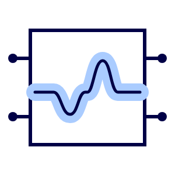
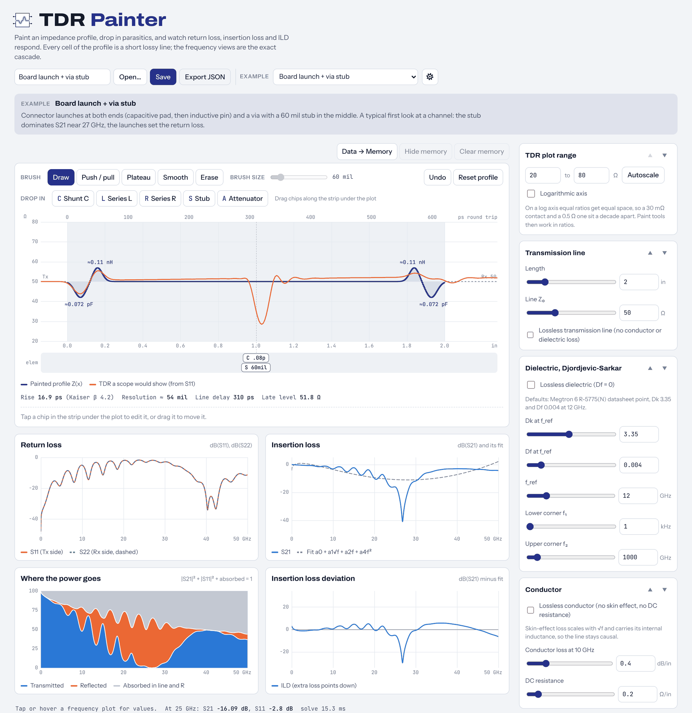

<p align="center">
  <picture>
    <source media="(prefers-color-scheme: dark)" srcset="doc/icon-dark.png">
    
  </picture>
</p>

<h1 align="center">TDR Painter</h1>

<p align="center">
  <a href="https://github.com/Sparamix/tdr-painter/releases"></a>
  <a href="LICENSE"></a>
  <a href="https://github.com/Sparamix/tdr-painter/actions/workflows/test.yml"></a>
</p>

<p align="center">
  <em>17 examples · 178/178 validation checks pass · one HTML file, no install · nothing leaves your browser · GPL-3.0</em>
</p>

**Paint a TDR impedance profile, drop in parasitics, and watch S11, S21, ILD and the power balance respond.**
A teaching tool for signal and power integrity: it shows how the shapes you see on a TDR become return loss and
insertion loss, and where that picture stops being enough.

**Current release: v0.8.2.** TDR Painter is pre-1.0 and still changing; see [Releases](https://github.com/Sparamix/tdr-painter/releases),
the [changelog](CHANGELOG.md) and the [roadmap](ROADMAP.md).

**[Open TDR Painter](https://sparamix.github.io/tdr-painter/)** in your browser, or download `index.html` from a
release (or [`dist/index.html`](dist/index.html) here) and open it from disk. It works offline.




## Who is this for?

- **Students** in SI/PI, microwave and EM courses who want to see why a capacitive dip on a TDR becomes a rising S11,
  and why a via stub notches S21
- **Instructors** who need a live demo for lecture: 17 built-in examples with notes, and project files to hand out
- **Engineers new to TDR** learning to read a scope trace: launches, via stubs, rise-time resolution, masking by an
  earlier mismatch, ghost reflections
- **Lab engineers** learning what good and bad probe contact on a calibration short look like on a TDR
  (experimental 1 mΩ to 1 MΩ range, log axis)

If something looks wrong or could teach better, please
[open an issue](https://github.com/Sparamix/tdr-painter/issues). That's how the tool gets better.


## What you can do

- **Paint** the profile with Draw, Push / pull, Plateau, Smooth and Erase. Short bumps are labeled with their
  equivalent lumped L or C.
- **Drop in** a shunt C, series L, series R, a stub (open, like a via stub, or shorted to ground) or a resistive
  attenuator (a T pad between Zin and Zout). Drag the chips along the strip under the plot; set copies and pitch for
  periodic loading; **Lock** an element, **Clone** it, or untick **Enabled** for a quick before and after.
- **Compare** with Data → Memory, as on a VNA: the stored curves stay on every plot as dots while solid lines follow
  your edits. Show/Hide and Clear memory sit next to it.
- **Read** the TDR a scope would show next to the profile you painted, with rise time, resolution and line delay;
  S11 and S22, S21 with its fitted loss, ILD, and where the power goes (transmitted, reflected, absorbed).
- **Tune** the line (length, Z₀), a Djordjevic-Sarkar dielectric (defaults: MEGTRON 6 datasheet point), skin-effect
  and DC conductor loss, port impedances, sweep range and the TDR window. Conductor and dielectric loss can each be
  switched off.
- **Arrange** the side panel with the arrows on each group (Shift+click moves to the top or bottom). Imperial or
  metric units and the experimental wide impedance range are in Settings (the gear).
- **Save** a project as a `.tdrp` file and **Open** it later, or drop it onto the page. **Export JSON** writes the
  same project as readable text; **Copy .s2p text** exports the current S-parameters as Touchstone.
  See [doc/FILE_FORMAT.md](doc/FILE_FORMAT.md).


## Examples

The Example menu groups 17 channels, each with a short note on what to look at and what to try next:

| Group | Examples |
|---|---|
| Basics | clean line, impedance tolerance ripple, painted taper, lossy creep on a 10 in line |
| Discontinuities | shunt C vs series L, via stub resonance, a pad compensated with series L, Rx pad capacitance |
| TDR artifacts | resolution of two close pads, masking by an earlier mismatch, a ghost spike after a via stub |
| Realistic channels | board launch with a via stub, probed 42 Ω stripline with good and bad contact, a 5 in serpentine with corner capacitance, a GSG probe on a short standard with good and bad contact |

Each example is a plain project file in [`examples/`](examples/), bundled into the page at build time. New ones are
welcome: see [CONTRIBUTING.md](CONTRIBUTING.md).


## Privacy

TDR Painter has no server side. The page sends nothing anywhere, uses no analytics or cookies, and keeps nothing in
browser storage. A project exists only as the file you save; Open reads a file you pick and validates every value
before using it.

You don't have to take that on trust:

- **The browser enforces it.** `index.html` carries a Content-Security-Policy with `default-src 'none'` and
  `connect-src 'none'`, so the browser refuses any connection the page might attempt. Fonts and the icon are
  embedded, so there are no font or image requests either.
- **You can watch it.** Open the browser's developer tools, Network tab: after the page itself loads, nothing else is
  requested, whatever you paint, save or open.
- **The tests check it.** `npm test` fails if a network or storage API, or any external URL, appears in the build.
  `test/ui_smoke.py` drives the page in Chromium, fails on any request beyond the page file, and confirms the CSP
  blocks a deliberate `fetch`.
- **It works offline.** Download `index.html` and open it from disk; nothing needs a server.

**About the hosted copy.** The page itself sends nothing, but loading it from
[sparamix.github.io](https://sparamix.github.io/tdr-painter/) is a request to GitHub, and GitHub Pages logs every
visitor's IP address for security purposes, signed in or not
([GitHub Docs](https://docs.github.com/en/pages/getting-started-with-github-pages/what-is-github-pages#data-collection)).
That log is GitHub's; this project receives nothing from it. If you'd rather not touch GitHub at all, use a copy of
`index.html` from disk.


## Validation

The engine is checked against independent models, textbook results and published data by
[`validation/`](validation/README.md). Every structure is built twice: once as a TDR Painter project run through the
page's own engine, once in [scikit-rf](https://scikit-rf.org/) from its own parts. **178 of 178 pass/fail checks
pass.**

| Tier | Compared with | Result |
|---|---|---|
| A | scikit-rf, same structure: S11, S21, S22 | agree to 4e-11 or better (limit 1e-9) |
| B | scikit-rf windowed step response: the TDR | agree to 2e-4 in ρ, about 0.02 Ω at 50 Ω (limit 1e-3) |
| P | Physics: DC limit, passivity, energy conservation, causality | all pass; non-causal negative controls are caught |
| X | Textbook: Beatty closed form, quarter-wave stub null, Bloch stopband, attenuator match and loss, contact resistance on a short | all pass |
| C | Painting the TDR you see: how close are the S-parameters? | informational, per case |
| R | A VNA measurement and an ANSYS Circuit simulation from scikit-rf's examples | TDR within 3.5 Ω of the measurement; \|S11\| within 0.023 of ANSYS |

Seven structures with distinct TDR signatures, 18 variants: a Beatty standard, a via with an open stub, periodic
shunt C, a probe launch with good and bad contact, a 10 in lossy taper, resistive attenuator pads, and a GSG probe on
a short standard.

**Full results: [validation/report/REPORT.md](validation/report/REPORT.md)**, including what the validation fixed
(the TDR was drawn half a sample early until v0.6.0) and its limits (it verifies the model; it does not validate it
against your board).


## How it works

- The profile is 500 equal cells. Each cell is a uniform lossy line of its painted impedance; lumped elements sit on
  cell boundaries. S-parameters come from the ABCD cascade, so they are exact for that structure.
- R′ and L′ scale with Z and C′ with 1/Z, so loss per inch is the same everywhere and only reflections change with
  what you paint.
- Dielectric: Djordjevic-Sarkar, `ε(f) = ε∞ + Δε·ln((f₂+jf)/(f₁+jf)) / ln(f₂/f₁)`, anchored to Dk and Df at f_ref
  (same form and corner defaults as scikit-rf's `djordjevicsvensson`). Defaults are the MEGTRON 6 R-5775(N)
  datasheet point, Dk 3.35 and Df 0.004 at 12 GHz.
- Conductor: `R_dc + (1+j)·K·√f` per unit length, which keeps the line causal.
- TDR: S11 times a Kaiser half-window centered on DC (β 4.2 by default), inverse FFT, trapezoid-rule integration (as
  scikit-rf's `step_response`), then `Z = Z_Tx(1+ρ)/(1−ρ)`. Time zero falls on a sample.
- Equivalent L/C labels use the TDR area method, `L = 2Z₀∫ρ dt` and `C = −(2/Z₀)∫ρ dt` over round-trip time.
- ILD is dB(S21) minus a least-squares fit of `a0 + a1√f + a2·f + a4·f²` over the sweep.
- 1-D TEM only: no radiation, coupling or mode conversion.

A full solve plus TDR takes milliseconds, so every plot follows the mouse as you paint.


## Develop

```sh
npm run build                    # src/ + fonts/ -> dist/index.html and dist/tdr-painter.artifact.html
npm test                         # build, engine, .tdrp container, examples and privacy checks (Node 18+, no dependencies)
python test/ui_smoke.py          # optional: drives the page in Chromium (needs Playwright)
python test/skrf_crosscheck.py   # optional: quick cross-check against scikit-rf
npm run validate                 # optional: the validation suite and report (pip install -r validation/requirements.txt)
```

| Path | What it is |
|---|---|
| `src/engine.js` | Physics: dielectric model, cascade, S-parameters, TDR, ILD fit |
| `src/project.js` | Project format: defaults, limits and the validating parser, shared with the tests |
| `src/tdrp.js` | `.tdrp` container: ZIP writer and reader with CRC-32 checks |
| `src/page.html` | UI; the `/*…*/` placeholders are replaced by the modules and examples at build time |
| `build.js` | Produces the two single-file builds in `dist/` |
| `examples/`, `tools/make-examples.js` | Built-in example projects and the script that generates them |
| `fonts/` | Self-hosted Archivo, Instrument Sans and JetBrains Mono, with their licenses |
| `test/` | Engine, container, example and privacy tests, scikit-rf cross-check, browser smoke test |
| `validation/` | Verification against scikit-rf, textbook results and published data, with its report |
| `doc/` | Icons, screenshot and the [project file format](doc/FILE_FORMAT.md) |


## Future features

[ROADMAP.md](ROADMAP.md) keeps the list with design notes: a TDR rise-time setting (and the window behind it), a
Smith chart view, and Touchstone import as a memory trace.


## Contributing

Contributions are very welcome: new examples, physics corrections, bug reports, UI improvements. The short version:
fork → branch → pull request against `main`; keep `npm test` green (and the validation suite for engine changes);
share only synthetic structures or data you are free to publish.

See [**CONTRIBUTING.md**](CONTRIBUTING.md) for how to submit an example, and the
[*Example idea*](https://github.com/Sparamix/tdr-painter/issues/new?template=example-idea.md) template if you have an
idea but no file.


## Citing

Using TDR Painter in a course, a talk or a paper? *We'd love to hear about it!*
[Open an issue](https://github.com/Sparamix/tdr-painter/issues) or get in touch (see [Contact](#contact)).

Click **"Cite this repository"** in the GitHub sidebar (it reads [`CITATION.cff`](CITATION.cff)), or use:

> G. Maghlakelidze, "TDR Painter: an in-browser TDR and S-parameter teaching tool," version 0.8.2, 2026.
> [Online]. Available: <https://github.com/Sparamix/tdr-painter>

```bibtex
@software{tdr_painter_2026,
  author  = {Maghlakelidze, Giorgi},
  title   = {{TDR Painter}: an in-browser {TDR} and {S}-parameter teaching tool},
  year    = {2026},
  version = {0.8.2},
  url     = {https://github.com/Sparamix/tdr-painter}
}
```


## Related

| Tool | Role |
|---|---|
| [octave-rf](https://github.com/Sparamix/octave-rf) | S-parameter network utilities for GNU Octave |
| [SQualCheck](https://github.com/Sparamix/SQualCheck) | S-parameter quality checking |
| [kit370](https://github.com/Sparamix/kit370) | A virtual de-embedding kit |
| [scikit-rf](https://scikit-rf.org/) | RF network analysis in Python; the reference for this project's validation |


## :warning: AI-Assisted Development Disclosure

This project was developed with the assistance of **Anthropic Claude Opus 5.5**. We believe in full transparency
about AI involvement in engineering work.

**We practice responsible vibe-coding.** AI accelerates development, but the physics in this tool goes through a
verification protocol before it ships:

1. **Independent reference models**: every validation structure is built a second time in scikit-rf from its own
   parts (RLGC lines, its Djordjevic-Svensson permittivity, tees, opens and shorts, lumped elements) and compared to
   the engine to round-off. 178/178 pass/fail checks pass.

2. **Physics and textbook checks**: DC limits, passivity, energy conservation, causality (with non-causal negative
   controls that must fail), the Beatty closed form, the quarter-wave stub null, the Bloch stopband and the
   minimum-loss pad formula.

3. **The protocol finds real bugs**: it showed that the TDR was drawn half a sample (1.2 ps) early, up to 3 Ω off on
   sharp edges, which was fixed before release. See the
   [findings](validation/report/REPORT.md#findings).

4. **Outside data**: a VNA measurement and an ANSYS Circuit simulation published with scikit-rf are compared as well
   (informational).

5. **Automated tests**: 131 unit, container, example and privacy checks run on every push; every built-in example
   must open cleanly and simulate as passive; a browser smoke test exercises the UI and confirms that the page makes
   no network requests.

6. **Clean-room implementation**: the engine is written from published equations (Djordjevic-Sarkar, the TDR area
   method, the fitted-loss ILD); no proprietary code was referenced. scikit-rf is used only as an independent
   reference in the validation, not in the page.

7. **Open to community scrutiny**: the validation code, reference files and report are in the repository.
   Independent checks and bug reports are welcome via [GitHub Issues](https://github.com/Sparamix/tdr-painter/issues).

The AI assisted with code generation, documentation and the verification workflow. The human author (a signal
integrity engineer) set the scope and the physics, chose the validation cases, reviewed the results and made the
engineering decisions.


## Attribution and scope

TDR Painter is a teaching model: a 1-D cascade of TEM line cells, not a field solver or a substitute for measurement.
Naming a product, a material or an instrument (MEGTRON, Keysight, Anritsu, ANSYS and others) is descriptive only and
implies no affiliation with, sponsorship by, or endorsement from its owner. All trademarks belong to their respective
owners. The validation's measurement and simulation data come from scikit-rf's examples under its BSD license; see
[THIRD-PARTY-NOTICES.md](THIRD-PARTY-NOTICES.md).


## References

- A. R. Djordjevic, R. M. Biljic, V. D. Likar-Smiljanic, T. K. Sarkar, "Wideband frequency-domain characterization
  of FR-4 and time-domain causality," IEEE Trans. EMC, vol. 43, no. 4, pp. 662–667, 2001.
- D. J. Dascher, "Measuring Parasitic Capacitance and Inductance Using TDR," Hewlett-Packard Journal, Apr. 1996.
- A. Healey, "Fitted insertion loss and insertion loss deviation," IEEE P802.3ba Task Force, Jul. 2009.
- Panasonic MEGTRON 6 R-5775(N) data sheet.
- H. Johnson, "Who's Afraid of the Big Bad Bend?", EDN (right-angle corner capacitance).
- PKWARE, APPNOTE.TXT, .ZIP File Format Specification.
- The validation report lists the references for each case: [validation/report/REPORT.md](validation/report/REPORT.md#references).


## License

TDR Painter is free software: you can redistribute it and/or modify it under the terms of the
**GNU General Public License, version 3 or (at your option) any later version**; see [LICENSE](LICENSE). In short:
use it, teach with it, change it, share it; if you distribute a modified version, share its source under the same
license.

Embedded fonts are under the SIL Open Font License 1.1, and the validation's third-party data under scikit-rf's BSD
3-Clause license; see [THIRD-PARTY-NOTICES.md](THIRD-PARTY-NOTICES.md).


## Contact

**Giorgi Maghlakelidze**
giorgi.snp [at] pm.me · [linkedin.com/in/giorgim](https://linkedin.com/in/giorgim)


---

**Note**: This tool is intended for education, not mission-critical use. While we strive for accuracy, please always
validate critical results with established professional tools and measurements.

<p align="center">Made with ❤️ for the Signal Integrity Community</p>
