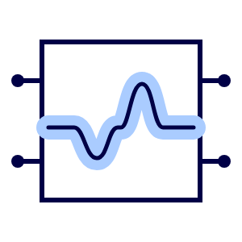
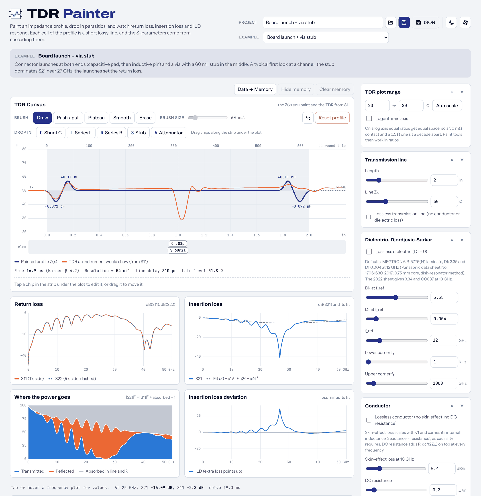

<p align="center">
  <picture>
    <source media="(prefers-color-scheme: dark)" srcset="doc/icon-dark.png">
    
  </picture>
</p>

<h1 align="center">TDR Painter</h1>

<p align="center">
  <a href="https://github.com/Sparamix/tdr-painter/releases"></a>
  <a href="LICENSE"></a>
  <a href="https://github.com/Sparamix/tdr-painter/actions/workflows/test.yml"></a>
</p>

<p align="center">
  <em>19 examples · 178/178 validation checks pass · one HTML file, no install · nothing leaves your browser · GPL-3.0</em>
</p>

**Paint a TDR impedance profile, drop in parasitics, and watch S11, S21, ILD and the power balance respond.**
A teaching tool for signal and power integrity: it shows how the shapes you see on a TDR become return loss and
insertion loss, and where that picture stops being enough.

**Current release: v0.8.12.** TDR Painter is pre-1.0 and still changing; see [Releases](https://github.com/Sparamix/tdr-painter/releases),
the [changelog](CHANGELOG.md) and the [roadmap](ROADMAP.md).

**[Open TDR Painter](https://sparamix.github.io/tdr-painter/)** in your browser, or download `index.html` from a
release (or [`dist/index.html`](dist/index.html) here) and open it from disk. It works offline.

<picture>
  <source media="(prefers-color-scheme: dark)" srcset="doc/screenshot-dark.png">
  
</picture>


## Who is this for?

- **Students** in SI/PI, microwave and EM courses who want to see why a capacitive dip on a TDR becomes a rising S11,
  and why a via stub notches S21
- **Instructors** who need a live demo for lecture: 19 built-in examples with notes, and project files to hand out
- **Engineers new to TDR** learning to read a scope trace: launches, via stubs, rise-time resolution, masking by an
  earlier mismatch, ghost reflections
- **Lab engineers** learning what a good landing, a bad signal contact and a lifted ground look like, on a
  calibration short and on a microstrip (the short uses the experimental 1 mΩ to 1 MΩ range and a log axis)

If something looks wrong or could teach better, please
[open an issue](https://github.com/Sparamix/tdr-painter/issues). That's how the tool gets better.


## What you can do

- **Paint** the profile on the TDR Canvas with Draw, Push / pull, Plateau, Smooth and Erase. Short bumps are labeled with their
  equivalent lumped L or C.
- **Drop in** a shunt C, series L, series R, a stub (open, like a via stub, or shorted to ground) or a resistive
  attenuator (a T pad between Zin and Zout). Drag the chips along the strip under the plot; set copies and pitch for
  periodic loading; **Lock** an element, **Clone** it, or untick **Enabled** for a quick before and after.
- **Compare** with Data → Memory, as on a VNA: the stored curves stay on every plot as dots while solid lines follow
  your edits. Show/Hide and Clear memory sit next to it.
- **Read** the TDR a scope would show next to the profile you painted, with rise time, resolution and line delay;
  S11 and S22, S21 with its fitted loss, ILD, and where the power goes (transmitted, reflected, absorbed).
- **Tune** the line (length, Z₀), a Djordjevic-Sarkar dielectric (defaults: MEGTRON 6 datasheet point), skin-effect
  and DC conductor loss, port impedances, sweep range and the TDR window. Conductor and dielectric loss can each be
  switched off.
- **Arrange** the side panel with the arrows on each group (Shift+click moves to the top or bottom). The sun/moon
  button beside the gear switches light and dark. Settings (the gear) holds imperial or metric units, a compact
  layout for laptop screens (on by default in short windows) and the experimental wide impedance range.
- **Save** a project as a `.tdrp` file and **Open** it later, or drop it onto the page. **Export JSON** writes the
  same project as readable text; **Copy .s2p text** exports the current S-parameters as Touchstone.
  See [doc/FILE_FORMAT.md](doc/FILE_FORMAT.md).


## Examples

The Example menu groups 19 channels, each with a short note on what to look at and what to try next:

| Group | Examples |
|---|---|
| Basics | clean line, impedance tolerance ripple, painted taper, lossy creep on a 10 in line |
| Discontinuities | shunt C vs series L, via stub resonance, a pad compensated with series L, Rx pad capacitance |
| TDR artifacts | resolution of two close pads, masking by an earlier mismatch, a ghost spike after a via stub |
| Realistic channels | board launch with a via stub, a 5 in serpentine with corner capacitance |
| Probing | a GSG probe on a cal short and on a 42 Ω microstrip, each with a good landing, a bad signal contact and a lifted ground tip |

Each example is a plain project file in [`examples/`](examples/), bundled into the page at build time. New ones are
welcome: see [CONTRIBUTING.md](CONTRIBUTING.md).


## Privacy

TDR Painter has no server side. The page sends nothing anywhere, uses no analytics or cookies, and keeps nothing in
browser storage. A project exists only as the file you save; Open reads a file you pick and validates every value
before using it.

You don't have to take that on trust:

- **The browser enforces it.** `index.html` carries a Content-Security-Policy with `default-src 'none'` and
  `connect-src 'none'`, so the browser refuses any connection the page might attempt. Fonts and the icon are
  embedded, so there are no font or image requests either.
- **You can watch it.** Open the browser's developer tools, Network tab: after the page itself loads, nothing else is
  requested, whatever you paint, save or open.
- **The tests check it.** `npm test` fails if a network or storage API, or any external URL, appears in the build.
  `test/ui_smoke.py` drives the page in Chromium, fails on any request beyond the page file, and confirms the CSP
  blocks a deliberate `fetch`.
- **It works offline.** Download `index.html` and open it from disk; nothing needs a server.

**About the hosted copy.** The page itself sends nothing, but loading it from
[sparamix.github.io](https://sparamix.github.io/tdr-painter/) is a request to GitHub, and GitHub Pages logs every
visitor's IP address for security purposes, signed in or not
([GitHub Docs](https://docs.github.com/en/pages/getting-started-with-github-pages/what-is-github-pages#data-collection)).
That log is GitHub's; this project receives nothing from it. If you'd rather not touch GitHub at all, use a copy of
`index.html` from disk.


## Validation

The engine is checked against independent models, textbook results and published data by
[`validation/`](validation/README.md). Every structure is built twice: once as a TDR Painter project run through the
page's own engine, once in [scikit-rf](https://scikit-rf.org/) from its own parts. **178 of 178 pass/fail checks
pass.**

| Tier | Compared with | Result |
|---|---|---|
| A | scikit-rf, same structure: S11, S21, S22 | agree to 4e-11 or better (limit 1e-9) |
| B | scikit-rf windowed step response: the TDR | agree to 2e-4 in ρ, about 0.02 Ω at 50 Ω (limit 1e-3) |
| P | Physics: DC limit, passivity, energy conservation, causality | all pass; non-causal negative controls are caught |
| X | Closed forms with page references: Beatty section, quarter-wave stub null, Bloch stopband, attenuator match and loss; and a DC-limit check of contact resistance on a short | all pass |
| C | Painting the TDR you see: how close are the S-parameters? | informational, per case |
| R | A VNA measurement and an ANSYS Circuit simulation from scikit-rf's examples | TDR within 3.5 Ω of the measurement; \|S11\| within 0.023 of ANSYS |

Seven structures with distinct TDR signatures, 18 variants: a Beatty standard, a via with an open stub, periodic
shunt C, a probe launch with good and bad contact, a 10 in lossy taper, resistive attenuator pads, and a GSG probe on
a short standard.

**Full results: [validation/report/REPORT.md](validation/report/REPORT.md)**, including what the validation fixed
(the TDR was drawn half a sample early until v0.6.0) and its limits (it verifies the model; it does not validate it
against your board).


## How it works

Numbers in brackets refer to the [References](#references) below.

- The profile is 500 equal cells. Each cell is a uniform lossy line of its painted impedance; lumped elements sit on
  cell boundaries. S-parameters come from the ABCD cascade [1, Sec. 4.4], converted to S with port impedances Z_Tx
  and Z_Rx that may differ [2, Table III], so they are exact for that structure.
- R′ and L′ scale with Z and C′ with 1/Z, so loss per inch is the same everywhere and only reflections change with
  what you paint.
- Dielectric: Djordjević-Sarkar [3, eq. (5)] without its DC-conductivity term,
  `ε(f) = ε∞ + Δε·ln((f₂+jf)/(f₁+jf)) / ln(f₂/f₁)`, anchored at one (Dk, Df) point at f_ref [4, Sec. 6.3.5], [5]:
  the same form as scikit-rf's `djordjevicsvensson` [6], [7], with its corner defaults of 1 kHz and 1 THz ([3] fitted
  10⁴ and 10¹² rad/s to FR-4). Defaults: MEGTRON 6 R-5775(N) laminate, Dk 3.35 and Df 0.004 at 12 GHz [8] (0.75 mm
  core, disk-resonator method); the 2022 data sheet gives 3.34 and 0.0037 at 13 GHz.
- Conductor: `R_dc + (1+j)·K·√f` per unit length. The skin term carries its internal inductance, a reactance equal to
  its resistance [9, eqs. (5)–(7)], which a causal √f resistance requires [10, Sec. 2.8], [4, App. E],
  [11, eq. (5)]. R_dc and the skin term are simply added, the simple approximation of [10, eq. [2.51]]: exact at DC,
  about R_dc high above the skin-effect onset.
- TDR: S11 times a Kaiser half-window centered on DC [12, eq. (1)], [13] (β 4.2 by default), inverse FFT,
  trapezoid-rule integration (as scikit-rf's `step_response` [6]), then `Z = Z_Tx(1+ρ)/(1−ρ)` [14, eq. (14.6)]:
  exact for a single termination, an estimate along a profile with several reflections. Time zero falls on a sample.
- Rise time is the 10–90 % rise time of the windowed step, as VNAs define it [16]. Resolution is the one-way distance
  v·t_r/2 that two reflections need to show separately, a rule of thumb [15, p. 14].
- Equivalent L/C labels use the TDR area method [17], `L = 2Z₀∫ρ dt` and `C = −(2/Z₀)∫ρ dt` over round-trip time; the
  label is that area computed from the painted profile, exact on a lossless line.
- ILD is the insertion loss, −dB(S21), minus its fitted value `a0 + a1√f + a2·f + a4·f²` (f in GHz). The fit weights
  each point by |S21| and runs from 0.05 GHz to f_max, as in OIF-CEI-04.0 [18, Sec. 12.2.1.1, eqs. (12-1)–(12-3)];
  positive ILD means more loss than the fit [18, eq. (10-3)]. Unlike OIF, the coefficients are not bounded, the fit
  ends at f_max rather than at a baud rate, and the sweep's step (f_max/1000, 50 MHz at the default 50 GHz) is
  coarser than the 10 MHz OIF asks for. An earlier IEEE 802.3 proposal fitted three terms, a1√f + a2·f + a4·f², from
  50 MHz to 7.5 GHz [19].
- Attenuator: an ideal resistive T pad between its image impedances [1, Sec. 8.2]. Between unequal impedances a pad
  matched at both ends loses at least `20·log₁₀(√r + √(r−1))` dB, r being the impedance ratio: the minimum-loss
  pad [10, Table 5.6], [20, ch. 11].
- 1-D TEM only: no radiation, coupling or mode conversion, and smooth conductors (no surface roughness).

A full solve plus TDR takes milliseconds, so every plot follows the mouse as you paint.


## Develop

```sh
npm run build                    # src/ + fonts/ -> dist/index.html and dist/tdr-painter.artifact.html
npm test                         # build, engine, .tdrp container, examples and privacy checks (Node 20.12+, no dependencies)
python test/ui_smoke.py          # optional: drives the page in Chromium (needs Playwright)
python test/skrf_crosscheck.py   # optional: quick cross-check against scikit-rf
npm run validate                 # optional: the validation suite and report (pip install -r validation/requirements.txt)
```

| Path | What it is |
|---|---|
| `src/engine.js` | Physics: dielectric model, cascade, S-parameters, TDR, ILD fit |
| `src/project.js` | Project format: defaults, limits and the validating parser, shared with the tests |
| `src/tdrp.js` | `.tdrp` container: ZIP writer and reader with CRC-32 checks, per APPNOTE.TXT [27] |
| `src/page.html` | UI; the `/*…*/` placeholders are replaced by the modules and examples at build time |
| `build.js` | Produces the two single-file builds in `dist/` |
| `examples/`, `tools/make-examples.js` | Built-in example projects and the script that generates them |
| `fonts/` | Self-hosted Archivo, Instrument Sans and JetBrains Mono, with their licenses |
| `test/` | Engine, container, example and privacy tests, scikit-rf cross-check, browser smoke test |
| `validation/` | Verification against scikit-rf, textbook results and published data, with its report |
| `doc/` | Icons, light and dark screenshots, the [project file format](doc/FILE_FORMAT.md) and the [sources](doc/SOURCES.md) behind the model |


## Future features

[ROADMAP.md](ROADMAP.md) keeps the list with design notes: a TDR rise-time setting (and the window behind it), a
TDR from the Rx port, a transmission-line drop-in element, a Smith chart view, and Touchstone import as a memory trace.


## Contributing

Contributions are very welcome: new examples, physics corrections, bug reports, UI improvements. The short version:
fork → branch → pull request against `main`; keep `npm test` green (and the validation suite for engine changes);
share only synthetic structures or data you are free to publish.

See [**CONTRIBUTING.md**](CONTRIBUTING.md) for how to submit an example, and the
[*Example idea*](https://github.com/Sparamix/tdr-painter/issues/new?template=example-idea.md) template if you have an
idea but no file.


## Citing

Using TDR Painter in a course, a talk or a paper? *We'd love to hear about it!*
[Open an issue](https://github.com/Sparamix/tdr-painter/issues) or get in touch (see [Contact](#contact)).

Click **"Cite this repository"** in the GitHub sidebar (it reads [`CITATION.cff`](CITATION.cff)), or use:

> G. Maghlakelidze, "TDR Painter: an in-browser TDR and S-parameter teaching tool," version 0.8.12, 2026.
> [Online]. Available: <https://github.com/Sparamix/tdr-painter>

```bibtex
@software{tdr_painter_2026,
  author  = {Maghlakelidze, Giorgi},
  title   = {{TDR Painter}: an in-browser {TDR} and {S}-parameter teaching tool},
  year    = {2026},
  version = {0.8.12},
  url     = {https://github.com/Sparamix/tdr-painter}
}
```


## Related

| Tool | Role |
|---|---|
| [octave-rf](https://github.com/Sparamix/octave-rf) | S-parameter network utilities for GNU Octave |
| [SQualCheck](https://github.com/Sparamix/SQualCheck) | S-parameter quality checking |
| [kit370](https://github.com/Sparamix/kit370) | A virtual de-embedding kit |
| [scikit-rf](https://scikit-rf.org/) | RF network analysis in Python; the reference for this project's validation |


## :warning: AI-Assisted Development Disclosure

This project was developed with the assistance of **Anthropic Claude Opus 5.5**. We believe in full transparency
about AI involvement in engineering work.

**We practice responsible vibe-coding.** AI accelerates development, but the physics in this tool goes through a
verification protocol before it ships:

1. **Independent reference models**: every validation structure is built a second time in scikit-rf from its own
   parts (RLGC lines, its Djordjevic-Svensson permittivity, tees, opens and shorts, lumped elements). S-parameters
   agree to 4e-11, the TDR to 2e-4 in ρ; 178/178 pass/fail checks pass.

2. **Physics and textbook checks**: DC limits, passivity, energy conservation, causality (with non-causal negative
   controls that must fail), the Beatty closed form, the quarter-wave stub null, the Bloch stopband and the
   minimum-loss pad formula.

3. **Literature check**: a separate Claude session checked every cited statement, equation and reference entry of
   v0.8.10 against the sources, page by page (133 items), under the author's direction. Its findings were fixed in
   v0.8.11; [doc/SOURCES.md](doc/SOURCES.md) lists every source and what it supports.

4. **The protocol finds real bugs**: it showed that the TDR was drawn half a sample (1.2 ps) early, up to 3 Ω off on
   sharp edges, which was fixed before release. See the
   [findings](validation/report/REPORT.md#findings).

5. **Outside data**: a VNA measurement and an ANSYS Circuit simulation published with scikit-rf are compared as well
   (informational).

6. **Automated tests**: 147 unit, container, example and privacy checks run on every push; every built-in example
   must open cleanly and simulate as passive; a browser smoke test exercises the UI and confirms that the page makes
   no network requests.

7. **Clean-room implementation**: the engine is written from published equations (Djordjevic-Sarkar, the TDR area
   method, the fitted-loss ILD); no proprietary code was referenced. scikit-rf is used only as an independent
   reference in the validation, not in the page.

8. **Open to community scrutiny**: the validation code, reference files and report are in the repository.
   Independent checks and bug reports are welcome via [GitHub Issues](https://github.com/Sparamix/tdr-painter/issues).

The AI assisted with code generation, documentation and the verification workflow. The human author (a signal
integrity engineer) set the scope and the physics, chose the validation cases, reviewed the results and made the
engineering decisions.


## Attribution and scope

TDR Painter is a teaching model: a 1-D cascade of TEM line cells, not a field solver or a substitute for measurement.
Naming a product, a material or an instrument (MEGTRON, Keysight, Anritsu, ANSYS and others) is descriptive only and
implies no affiliation with, sponsorship by, or endorsement from its owner. All trademarks belong to their respective
owners. The validation's measurement and simulation data come from scikit-rf's examples under its BSD license; see
[THIRD-PARTY-NOTICES.md](THIRD-PARTY-NOTICES.md).


## References

Model, cited under [How it works](#how-it-works):

1. D. M. Pozar, *Microwave Engineering*, 4th ed. Hoboken, NJ, USA: Wiley, 2012.
2. D. A. Frickey, "Conversions between S, Z, Y, h, ABCD, and T parameters which are valid for complex source and load
   impedances," *IEEE Trans. Microw. Theory Techn.*, vol. 42, no. 2, pp. 205–211, Feb. 1994,
   doi: [10.1109/22.275248](https://doi.org/10.1109/22.275248).
3. A. R. Djordjević, R. M. Biljić, V. D. Likar-Smiljanić, and T. K. Sarkar, "Wideband frequency-domain
   characterization of FR-4 and time-domain causality," *IEEE Trans. Electromagn. Compat.*, vol. 43, no. 4,
   pp. 662–667, Nov. 2001, doi: [10.1109/15.974647](https://doi.org/10.1109/15.974647).
4. S. H. Hall and H. L. Heck, *Advanced Signal Integrity for High-Speed Digital Designs*. Hoboken, NJ, USA: Wiley,
   2009.
5. Y. Shlepnev, "Broadband material model identification with GMS-parameters," in *Proc. IEEE 24th Elect. Perform.
   Electron. Packag. Syst. (EPEPS)*, San Jose, CA, USA, Oct. 2015, pp. 155–158,
   doi: [10.1109/EPEPS.2015.7347151](https://doi.org/10.1109/EPEPS.2015.7347151).
6. scikit-rf developers, *scikit-rf*, ver. 2.2.0. [Online]. Available: https://scikit-rf.org
7. A. Arsenovic *et al.*, "scikit-rf: An open source Python package for microwave network creation, analysis, and
   calibration [Speaker's Corner]," *IEEE Microw. Mag.*, vol. 23, no. 1, pp. 98–105, Jan. 2022,
   doi: [10.1109/MMM.2021.3117139](https://doi.org/10.1109/MMM.2021.3117139).
8. Panasonic, "Laminate R-5775(N), prepreg R-5670(N): High speed, low loss multi-layer materials (low Dk glass cloth
   version)," Data Sheet No. 17061630, Jun. 2017. Superseded by No. 22040130, Apr. 2022.
9. H. A. Wheeler, "Formulas for the skin effect," *Proc. IRE*, vol. 30, no. 9, pp. 412–424, Sep. 1942,
   doi: [10.1109/JRPROC.1942.232015](https://doi.org/10.1109/JRPROC.1942.232015).
10. H. Johnson and M. Graham, *High-Speed Signal Propagation: Advanced Black Magic*. Upper Saddle River, NJ, USA:
    Prentice Hall, 2003.
11. C. Svensson and G. E. Dermer, "Time domain modeling of lossy interconnects," *IEEE Trans. Adv. Packag.*, vol. 24,
    no. 2, pp. 191–196, May 2001, doi: [10.1109/6040.928754](https://doi.org/10.1109/6040.928754).
12. J. F. Kaiser and R. W. Schafer, "On the use of the I0-sinh window for spectrum analysis," *IEEE Trans. Acoust.,
    Speech, Signal Process.*, vol. ASSP-28, no. 1, pp. 105–107, Feb. 1980,
    doi: [10.1109/TASSP.1980.1163349](https://doi.org/10.1109/TASSP.1980.1163349). It calls the window parameter α;
    TDR Painter calls it β.
13. SciPy developers, "scipy.signal.windows.kaiser," in *SciPy v1.18.0 Manual*. [Online]. Available:
    https://docs.scipy.org/doc/scipy/reference/generated/scipy.signal.windows.kaiser.html
14. P. J. Pupalaikis, *S-Parameters for Signal Integrity*. Cambridge, U.K.: Cambridge Univ. Press, 2020,
    doi: [10.1017/9781108784863](https://doi.org/10.1017/9781108784863).
15. Keysight Technologies, "High precision time domain reflectometry (TDR)," Appl. Note 5988-9826EN, Jan. 29, 2024.
16. Keysight Technologies, "Transformation to time domain," E5071C network analyzer online help. [Online]. Available:
    https://helpfiles.keysight.com/csg/e5071c/measurement_with_options/time_domain_analysis/transformation_to_time_domain.htm
17. D. J. Dascher, "Measuring parasitic capacitance and inductance using TDR," *Hewlett-Packard J.*, vol. 47, no. 2,
    pp. 83–96, Apr. 1996.
18. Optical Internetworking Forum, "Common electrical I/O (CEI): Electrical and jitter interoperability agreements for
    6G+ bps, 11G+ bps, 25G+ bps I/O and 56G+ bps," Implementation Agreement OIF-CEI-04.0, Dec. 29, 2017. [Online].
    Available: https://www.oiforum.com/wp-content/uploads/2019/01/OIF-CEI-04.0.pdf
19. A. Healey, "Proposed text for fitted insertion loss," IEEE P802.3ba Task Force, San Francisco, CA, USA,
    doc. healey_05_0709, Jul. 15, 2009. [Online]. Available:
    https://www.ieee802.org/3/ba/public/jul09/healey_05_0709.pdf
20. W. M. Middleton and M. E. Van Valkenburg, Eds., *Reference Data for Engineers: Radio, Electronics, Computer, and
    Communications*, 9th ed. Boston, MA, USA: Newnes, 2002, ch. 11.

Examples, file format and roadmap:

21. H. Johnson, "Who's afraid of the big bad bend?," *EDN*, May 11, 2000. [Online]. Available:
    https://sigcon.com/Pubs/edn/bigbadbend.htm (the corner capacitance in the serpentine example).
22. E. Hammerstad and Ø. Jensen, "Accurate models for microstrip computer-aided design," in *IEEE MTT-S Int. Microw.
    Symp. Dig.*, Washington, DC, USA, May 1980, pp. 407–409,
    doi: [10.1109/MWSYM.1980.1124303](https://doi.org/10.1109/MWSYM.1980.1124303) (the microstrip examples).
23. FormFactor, "InfinityXT probe: RF/mmW probe series," Data Sheet INFINITYXT-DS-0820, 2020 (probe contact
    resistance).
24. FormFactor, "Infinity Probe mechanical layout rules," Appl. Note InfLayoutRule-AN-1115, 2022; and FormFactor,
    "Layout rules for GHz-probing," Appl. Note Layout-0720, 2020 (GS and GSG inductance).
25. [Author not named on the slides], "Probe tip characterization using self-calibration," Lab. RF Modeling,
    Fachhochschule Würzburg-Schweinfurt, presented at AK Bipolarmodellierung, 2008. [Online]. Available:
    https://www.iee.et.tu-dresden.de/iee/eb/forsch/AK-Bipo/2008/AKB2008_10_Baureis_Probe_Characterization2.pdf
    (short-standard inductance through GS and GSG probes).
26. E. Bogatin, *Bogatin's Practical Guide to Transmission Line Design and Characterization for Signal Integrity
    Applications*. Norwood, MA, USA: Artech House, 2020 (TDR masking, series resistance and time to distance, in the
    [roadmap](ROADMAP.md)).
27. PKWARE Inc., "APPNOTE.TXT – .ZIP file format specification," ver. 6.3.10, Nov. 1, 2022. [Online]. Available:
    https://pkware.cachefly.net/webdocs/casestudies/APPNOTE.TXT (the `.tdrp` container).

The validation report lists the references for each case:
[validation/report/REPORT.md](validation/report/REPORT.md#references). [doc/SOURCES.md](doc/SOURCES.md) lists every
source used to check the model and the docs, with the statement each supports and where: the ones cited here, the
ones checked but not cited, and the ones withdrawn.


## License

TDR Painter is free software: you can redistribute it and/or modify it under the terms of the
**GNU General Public License, version 3 or (at your option) any later version**; see [LICENSE](LICENSE). In short:
use it, teach with it, change it, share it; if you distribute a modified version, share its source under the same
license.

Embedded fonts are under the SIL Open Font License 1.1, and the validation's third-party data under scikit-rf's BSD
3-Clause license; see [THIRD-PARTY-NOTICES.md](THIRD-PARTY-NOTICES.md).


## Contact

**Giorgi Maghlakelidze**
giorgi.snp [at] pm.me · [linkedin.com/in/giorgim](https://linkedin.com/in/giorgim)


---

**Note**: This tool is intended for education, not mission-critical use. While we strive for accuracy, please always
validate critical results with established professional tools and measurements.

<p align="center">Made with ❤️ for the Signal Integrity Community</p>
