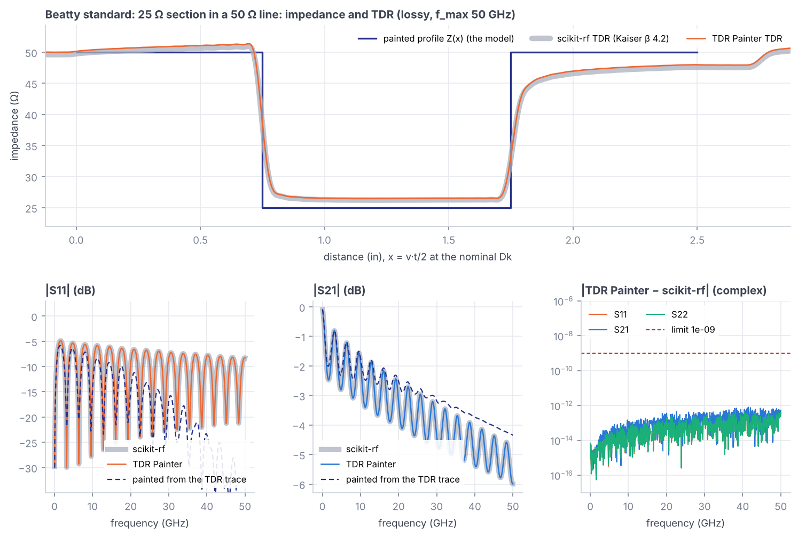
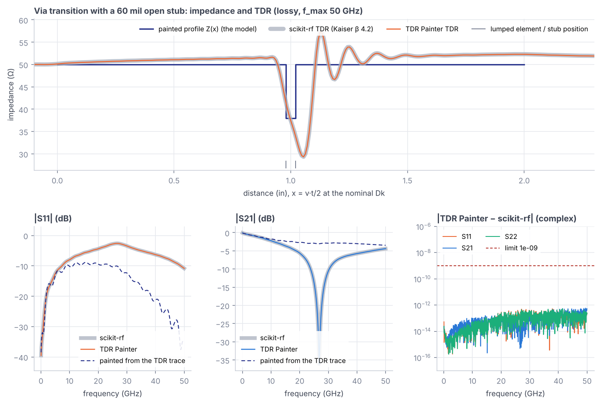
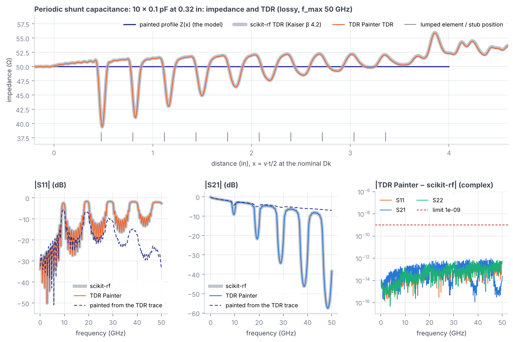
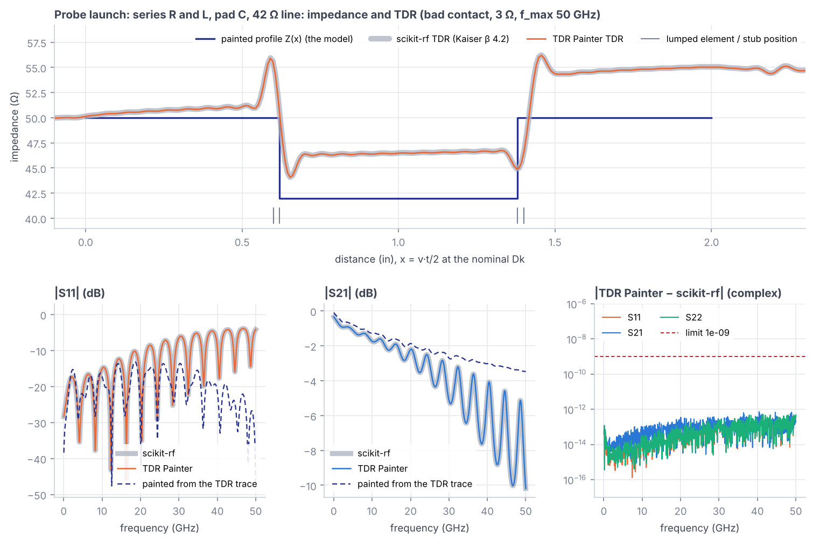
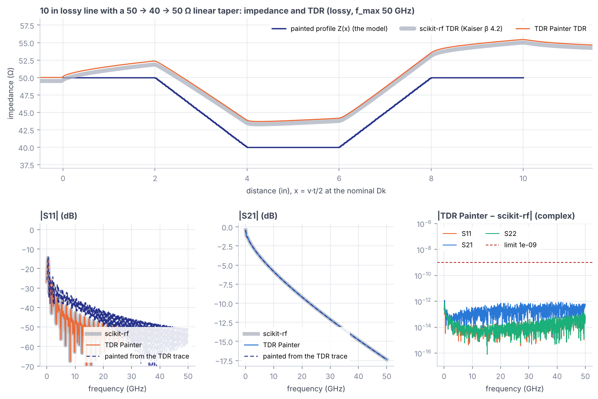
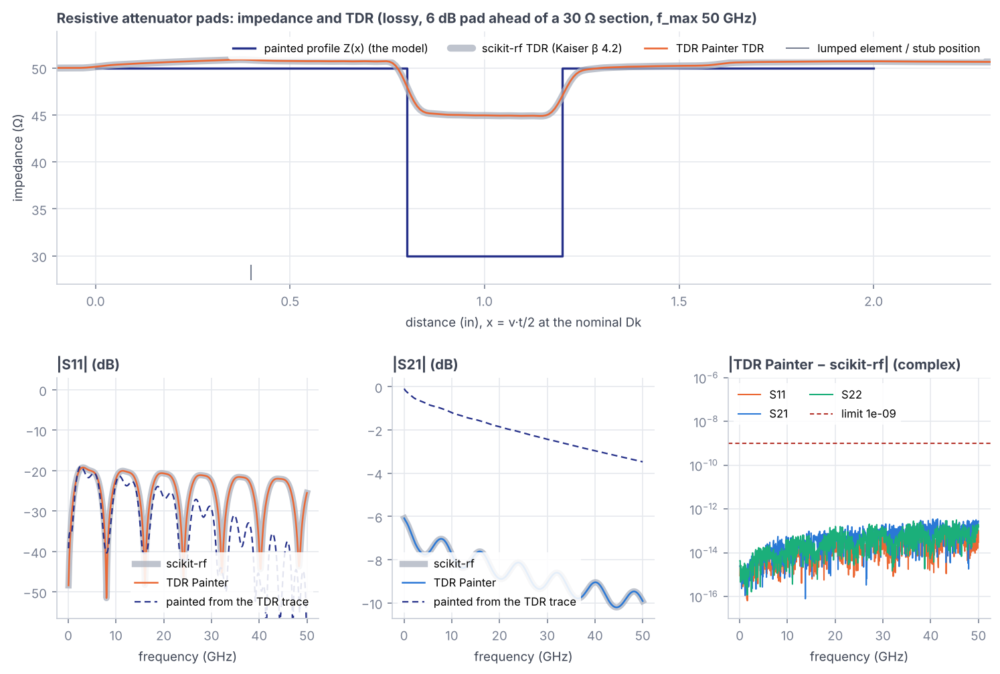
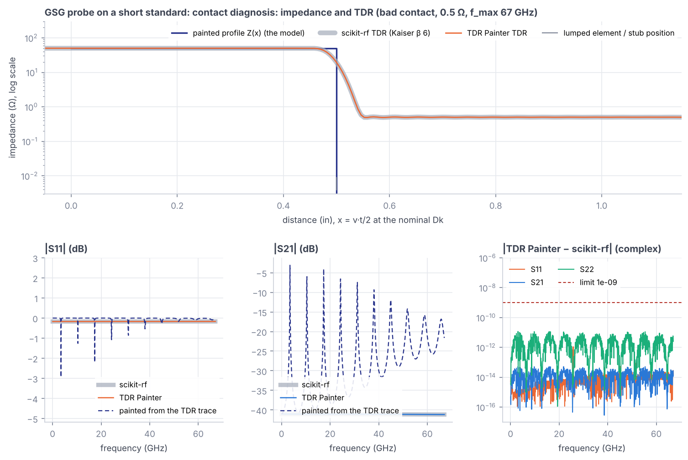
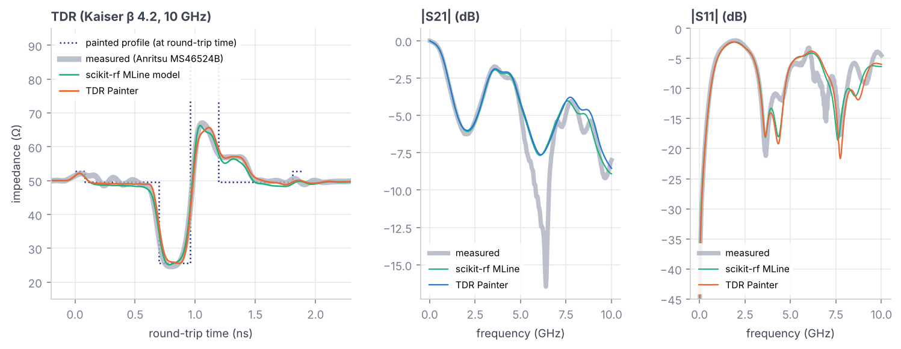
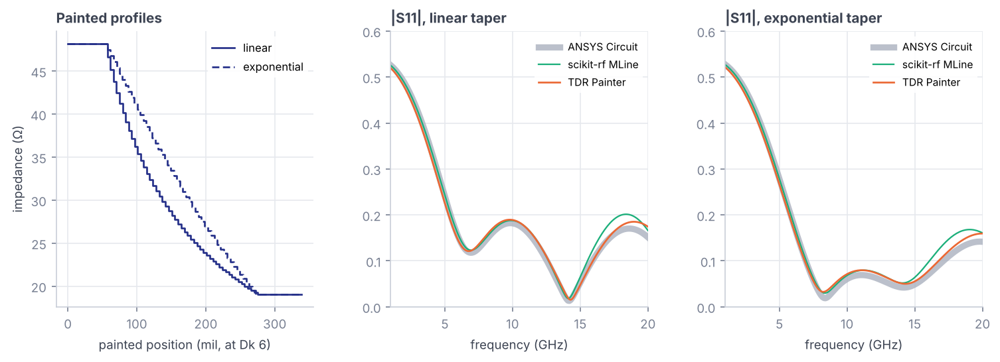

# TDR Painter verification report

Generated 2026-11-09 by `validation/run_validation.py` with TDR Painter 0.8.8, scikit-rf 2.2.0, NumPy 2.5.3, SciPy 1.18.1, Python 3.13.18 and Node v22.23.4. Rerun the script to regenerate this file; do not edit it by hand.

**Result: all pass/fail checks passed** (178 passed).

## What is checked

TDR Painter computes S-parameters from the painted impedance profile and the lumped elements (an exact cascade), then derives the TDR from S11. Each structure below is built twice, independently: once as a TDR Painter project (simulated by the page’s own `src/engine.js`) and once in scikit-rf from the same physical description (RLGC `DistributedCircuit` lines, scikit-rf’s Djordjevic-Svensson permittivity, tees and opens for stubs, lumped elements, renormalization to the port impedances).

| Tier | Question | Pass/fail |
| --- | --- | --- |
| A | Same structure, same S-parameters? | max complex difference ≤ 1e-09 |
| B | Same TDR as scikit-rf’s windowed step response? | max \|Δρ\| ≤ 1e-03 (≈ 0.1 Ω at 50 Ω) |
| P | Physics: DC limit, passivity, energy conservation when lossless, causality | see each table |
| X | Textbook results: Beatty closed form, quarter-wave stub null, Bloch stopband | see each table |
| C | If you paint the TDR trace you see, how close are the S-parameters? | informational: band where \|ΔS21\| ≤ 0.5 dB and abs(Δ\|S11\|) ≤ 0.05 |
| R | How close to a measurement and a commercial solver (cases from scikit-rf’s documentation)? | informational |

## Summary

| Case | A: max \|ΔS\| | B: max \|Δρ\| | P and X | C: paint the 50 GHz TDR | C: paint a 110 GHz TDR |
| --- | --- | --- | --- | --- | --- |
| [Beatty standard: 25 Ω section in a 50 Ω line](#beatty-standard-25-ω-section-in-a-50-ω-line) | 8e-13 | 1e-04 | 9/9 pass | agrees to 1.4 GHz | agrees to 1.4 GHz |
| [Via transition with a 60 mil open stub](#via-transition-with-a-60-mil-open-stub) | 6e-13 | 6e-05 | 8/8 pass | agrees to 6.8 GHz | agrees to 7.2 GHz |
| [Periodic shunt capacitance: 10 × 0.1 pF at 0.32 in](#periodic-shunt-capacitance-10--01-pf-at-032-in) | 2e-12 | 2e-04 | 9/9 pass | agrees to 7.3 GHz | agrees to 7.3 GHz |
| [Probe launch: series R and L, pad C, 42 Ω line](#probe-launch-series-r-and-l-pad-c-42-ω-line) | 7e-13 | 7e-05 | 9/9 pass | agrees to 5.5 GHz | agrees to 5.5 GHz |
| [10 in lossy line with a 50 → 40 → 50 Ω linear taper](#10-in-lossy-line-with-a-50--40--50-ω-linear-taper) | 1e-11 | 2e-06 | 7/7 pass | agrees to whole band | agrees to whole band |
| [Resistive attenuator pads](#resistive-attenuator-pads) | 4e-13 | 9e-06 | 13/13 pass | agrees to 0.1 GHz | agrees to 0.1 GHz |
| [GSG probe on a short standard: contact diagnosis](#gsg-probe-on-a-short-standard-contact-diagnosis) | 4e-11 | 2e-04 | 15/15 pass | agrees to 0.7 GHz | agrees to 0.7 GHz |

Tier R, against the outside world: on the [measured stepped microstrip](#stepped-impedance-microstrip-measured) TDR Painter’s TDR is within 3.5 Ω of the measurement (scikit-rf’s own MLine model: 2.6 Ω); on the [microstrip tapers](#microstrip-taper-into-15-ω-ansys-circuit) its |S11| is within 0.023 of ANSYS Circuit (scikit-rf’s MLine: 0.037).

## Findings

1. **Engine and scikit-rf agree to round-off.** For every structure and variant, S11, S21 and S22 from TDR Painter match
   scikit-rf to 4e-11 or better, across lossy lines, tapers, stubs, lumped R, L and C, and unequal port impedances.
2. **Fixed by this work: the TDR was drawn half a sample (1.2 ps) early.** The engine integrated the impulse response
   with a running sum; scikit-rf uses the trapezoid rule. The engine now uses the trapezoid rule as well, and places
   t = 0 on a sample so that both tools sample the same instants. With the v0.5.0 engine the TDR differed from
   scikit-rf by up to 0.029 in ρ (about 3 Ω at 50 Ω) on sharp edges; now the largest difference over all cases is
   2e-04, the size of a one-bin difference in how the two tools define the Kaiser window’s edge.
3. **scikit-rf’s `step_response` sits slightly off on lossy lines.** It extrapolates S11 to DC linearly and integrates
   from half a record (1/(2Δf)) before t = 0, so the slow conductor-loss tail that wraps around the record turns into
   a small offset. Run that way, it differs from TDR Painter by up to 5e-03 in ρ (on the
   10 in lossy line with a 50 → 40 → 50 Ω linear taper). Against a reference computed on a 10× finer frequency grid (no wrap-around to speak of), TDR Painter is within 2e-03 on every lossy case and scikit-rf’s `step_response` within 6e-03. For lossless structures the two agree. The tier B pass/fail
   check therefore compares like with like (same DC value, same integration start), and the as-a-user comparison is
   listed for information.
4. **Painting the TDR is a good model only where the TDR resolves the structure.** Tier C shows how far you get by
   tracing the TDR you see into a profile. It works for smooth features much longer than the rise time (the 10 in
   taper agrees over the whole band) and fails for what a 1-D impedance profile cannot hold or the TDR blurs: a
   shunt stub’s resonance, the loss of a series resistor, closely spaced lumped elements, and the downstream
   impedance after a large step, which the TDR shows shifted by multiple reflections.

## Beatty standard: 25 Ω section in a 50 Ω line

A 1 in, 25 Ω section between 0.75 in leads of 50 Ω stripline. The stepped-impedance airline used in VNA verification kits, here as a stripline.

Project files: [`cases/beatty.json`](../cases/beatty.json) (opens in TDR Painter), plus one per variant. scikit-rf reference (first variant, referenced to 50 Ω): [`reference/beatty.s2p`](../reference/beatty.s2p).

**Lossy**

| Tier | Check | Value | Limit | Result |
| --- | --- | --- | --- | --- |
| A | S11: max \|engine − scikit-rf\| | 4.2e-13 | 1.0e-09 | pass |
| A | S21: max \|engine − scikit-rf\| | 8.1e-13 | 1.0e-09 | pass |
| A | S22: max \|engine − scikit-rf\| | 4.2e-13 | 1.0e-09 | pass |
| A | scikit-rf reference is reciprocal: max \|S12 − S21\| | 3.5e-15 | 1.0e-10 | pass |
| P | DC: \|S11(0) − closed form\|, \|S21(0) − closed form\| | 1.1e-16 | 1.0e-12 | pass |
| P | passivity: max singular value of S − 1 | -2.2e-16 | 1.0e-12 | pass |
| P | causality: S21 impulse before the light-speed front / peak | 2.4e-05 | 3.0e-04 | pass |
| B | TDR: max \|ρ engine − ρ scikit-rf\| (exact DC, same integration start) | 6.9e-05 | 1.0e-03 | pass |
| B | TDR: max \|ρ engine − ρ on a 10× finer frequency grid\| | 3.4e-04 | 3.0e-03 | pass |
| B | TDR: scikit-rf step_response as a user runs it (linear DC extrapolation) | max \|Δρ\| vs engine 4.1e-03; on the 10× finer grid, scikit-rf’s step_response is off by 4.4e-03 |  | info |

**Lossless**

| Tier | Check | Value | Limit | Result |
| --- | --- | --- | --- | --- |
| A | S11: max \|engine − scikit-rf\| | 2.4e-13 | 1.0e-09 | pass |
| A | S21: max \|engine − scikit-rf\| | 2.4e-13 | 1.0e-09 | pass |
| A | S22: max \|engine − scikit-rf\| | 1.8e-13 | 1.0e-09 | pass |
| A | scikit-rf reference is reciprocal: max \|S12 − S21\| | 3.6e-13 | 1.0e-10 | pass |
| P | DC: \|S11(0) − closed form\|, \|S21(0) − closed form\| | 0.0e+00 | 1.0e-12 | pass |
| P | passivity: max singular value of S − 1 | 8.9e-16 | 1.0e-12 | pass |
| P | lossless energy: max \| \|S11\|² + \|S21\|² − 1 \| (both ports) | 1.0e-15 | 1.0e-12 | pass |
| P | causality: S21 impulse before the light-speed front / peak | 2.7e-05 | 3.0e-04 | pass |
| X | closed-form S11, S21 (max \|error\|) | 3.0e-14 | 1.0e-09 | pass |
| X | peak \|S11\| = 2\|Γ\|/(1+Γ²) = 0.6 (first peak 1.61 GHz) | 9.3e-07 | 1.0e-03 | pass |
| B | TDR: max \|ρ engine − ρ scikit-rf\| (exact DC, same integration start) | 1.1e-04 | 1.0e-03 | pass |
| B | TDR: scikit-rf step_response as a user runs it (linear DC extrapolation) | max \|Δρ\| vs engine 8.4e-05 |  | info |

**Paint the TDR, then simulate (tier C)**

| Painted from | Agrees to | max \|ΔS21\| up to 10 GHz | max \|ΔS21\| to f_max | S21 at DC, painted vs real |
| --- | --- | --- | --- | --- |
| scikit-rf 50 GHz TDR | 1.4 GHz | 0.64 dB | 1.7 dB | -0.034 vs -0.035 dB |
| scikit-rf 110 GHz TDR | 1.4 GHz | 0.55 dB | 1.4 dB | -0.034 vs -0.035 dB |

The painted-from-TDR model gets the 25 Ω plateau right, but the line after the section comes out at about 46 to 48 Ω instead of 50 Ω: past a large step the TDR still carries the two-way transmission through it and the multiple reflections inside the section, and painting takes both for impedance. The edge blur and the conductor-loss creep get painted too. S21 stays close at low frequency, while the S11 ripple pattern drifts as frequency rises.

## Via transition with a 60 mil open stub

50 Ω stripline into a via: 0.06 pF of pad capacitance, a 40 mil, 38 Ω barrel, and a 60 mil, 45 Ω open stub hanging off its far end, then 50 Ω stripline out.

Project files: [`cases/via-stub.json`](../cases/via-stub.json) (opens in TDR Painter), plus one per variant. scikit-rf reference (first variant, referenced to 50 Ω): [`reference/via-stub.s2p`](../reference/via-stub.s2p).

**Lossy**

| Tier | Check | Value | Limit | Result |
| --- | --- | --- | --- | --- |
| A | S11: max \|engine − scikit-rf\| | 5.2e-13 | 1.0e-09 | pass |
| A | S21: max \|engine − scikit-rf\| | 5.9e-13 | 1.0e-09 | pass |
| A | S22: max \|engine − scikit-rf\| | 5.3e-13 | 1.0e-09 | pass |
| A | scikit-rf reference is reciprocal: max \|S12 − S21\| | 7.7e-14 | 1.0e-10 | pass |
| P | DC: \|S11(0) − closed form\|, \|S21(0) − closed form\| | 8.7e-19 | 1.0e-12 | pass |
| P | passivity: max singular value of S − 1 | 4.4e-16 | 1.0e-12 | pass |
| P | causality: S21 impulse before the light-speed front / peak | 2.8e-05 | 3.0e-04 | pass |
| B | TDR: max \|ρ engine − ρ scikit-rf\| (exact DC, same integration start) | 4.6e-05 | 1.0e-03 | pass |
| B | TDR: max \|ρ engine − ρ on a 10× finer frequency grid\| | 7.8e-04 | 3.0e-03 | pass |
| B | TDR: scikit-rf step_response as a user runs it (linear DC extrapolation) | max \|Δρ\| vs engine 3.1e-04; on the 10× finer grid, scikit-rf’s step_response is off by 1.0e-03 |  | info |

**Lossless, grid point on the quarter-wave**

| Tier | Check | Value | Limit | Result |
| --- | --- | --- | --- | --- |
| A | S11: max \|engine − scikit-rf\| | 1.5e-13 | 1.0e-09 | pass |
| A | S21: max \|engine − scikit-rf\| | 2.5e-13 | 1.0e-09 | pass |
| A | S22: max \|engine − scikit-rf\| | 1.4e-13 | 1.0e-09 | pass |
| A | scikit-rf reference is reciprocal: max \|S12 − S21\| | 9.4e-14 | 1.0e-10 | pass |
| P | DC: \|S11(0) − closed form\|, \|S21(0) − closed form\| | 0.0e+00 | 1.0e-12 | pass |
| P | passivity: max singular value of S − 1 | 6.7e-16 | 1.0e-12 | pass |
| P | lossless energy: max \| \|S11\|² + \|S21\|² − 1 \| (both ports) | 1.1e-15 | 1.0e-12 | pass |
| P | causality: S21 impulse before the light-speed front / peak | 3.1e-05 | 3.0e-04 | pass |
| X | \|S21\| at the stub quarter-wave v/(4ℓ) = 26.869 GHz (grid point 537) | 7.5e-16 | 1.0e-09 | pass |
| B | TDR: max \|ρ engine − ρ scikit-rf\| (exact DC, same integration start) | 6.5e-05 | 1.0e-03 | pass |
| B | TDR: scikit-rf step_response as a user runs it (linear DC extrapolation) | max \|Δρ\| vs engine 7.7e-05 |  | info |

**Paint the TDR, then simulate (tier C)**

| Painted from | Agrees to | max \|ΔS21\| up to 10 GHz | max \|ΔS21\| to f_max | S21 at DC, painted vs real |
| --- | --- | --- | --- | --- |
| scikit-rf 50 GHz TDR | 6.8 GHz | 0.45 dB | 33.1 dB | -0.035 vs -0.035 dB |
| scikit-rf 110 GHz TDR | 7.2 GHz | 0.36 dB | 31.9 dB | -0.035 vs -0.035 dB |

The stub’s quarter-wave notch near 27 GHz cannot come from painting the TDR: a shunt resonator has no equivalent in a series impedance profile at this resolution, and its TDR signature is only a dip and some ringing. This is why TDR Painter has a separate stub element.

## Periodic shunt capacitance: 10 × 0.1 pF at 0.32 in

A 4 in, 50 Ω line loaded with ten 0.1 pF shunt capacitors every 0.32 in, like vias or connector pins along a bus. Periodic loading opens a stopband near v/(2p).

Project files: [`cases/periodic-c.json`](../cases/periodic-c.json) (opens in TDR Painter), plus one per variant. scikit-rf reference (first variant, referenced to 50 Ω): [`reference/periodic-c.s2p`](../reference/periodic-c.s2p).

**Lossy**

| Tier | Check | Value | Limit | Result |
| --- | --- | --- | --- | --- |
| A | S11: max \|engine − scikit-rf\| | 6.2e-13 | 1.0e-09 | pass |
| A | S21: max \|engine − scikit-rf\| | 9.5e-13 | 1.0e-09 | pass |
| A | S22: max \|engine − scikit-rf\| | 6.9e-13 | 1.0e-09 | pass |
| A | scikit-rf reference is reciprocal: max \|S12 − S21\| | 1.3e-14 | 1.0e-10 | pass |
| P | DC: \|S11(0) − closed form\|, \|S21(0) − closed form\| | 1.1e-16 | 1.0e-12 | pass |
| P | passivity: max singular value of S − 1 | 2.2e-16 | 1.0e-12 | pass |
| P | causality: S21 impulse before the light-speed front / peak | 1.3e-05 | 3.0e-04 | pass |
| B | TDR: max \|ρ engine − ρ scikit-rf\| (exact DC, same integration start) | 1.3e-04 | 1.0e-03 | pass |
| B | TDR: max \|ρ engine − ρ on a 10× finer frequency grid\| | 4.4e-04 | 3.0e-03 | pass |
| B | TDR: scikit-rf step_response as a user runs it (linear DC extrapolation) | max \|Δρ\| vs engine 8.7e-04; on the 10× finer grid, scikit-rf’s step_response is off by 7.5e-04 |  | info |

**Lossless**

| Tier | Check | Value | Limit | Result |
| --- | --- | --- | --- | --- |
| A | S11: max \|engine − scikit-rf\| | 1.6e-12 | 1.0e-09 | pass |
| A | S21: max \|engine − scikit-rf\| | 6.7e-13 | 1.0e-09 | pass |
| A | S22: max \|engine − scikit-rf\| | 4.5e-13 | 1.0e-09 | pass |
| A | scikit-rf reference is reciprocal: max \|S12 − S21\| | 3.6e-13 | 1.0e-10 | pass |
| P | DC: \|S11(0) − closed form\|, \|S21(0) − closed form\| | 0.0e+00 | 1.0e-12 | pass |
| P | passivity: max singular value of S − 1 | 1.3e-15 | 1.0e-12 | pass |
| P | lossless energy: max \| \|S11\|² + \|S21\|² − 1 \| (both ports) | 3.2e-15 | 1.0e-12 | pass |
| P | causality: S21 impulse before the light-speed front / peak | 2.3e-06 | 3.0e-04 | pass |
| X | S21 minimum (9.65 GHz) lies in the Bloch stopband 9.16 to 10.08 GHz (0 = yes) | 0 | 0 | pass |
| X | largest \|S21\| inside the stopband, below the smallest \|S21\| in the passband under 0.8 × its edge (0.99) | 0.55 | 0.99 | pass |
| B | TDR: max \|ρ engine − ρ scikit-rf\| (exact DC, same integration start) | 1.8e-04 | 1.0e-03 | pass |
| B | TDR: scikit-rf step_response as a user runs it (linear DC extrapolation) | max \|Δρ\| vs engine 2.2e-04 |  | info |

**Paint the TDR, then simulate (tier C)**

| Painted from | Agrees to | max \|ΔS21\| up to 10 GHz | max \|ΔS21\| to f_max | S21 at DC, painted vs real |
| --- | --- | --- | --- | --- |
| scikit-rf 50 GHz TDR | 7.3 GHz | 4.84 dB | 50.7 dB | -0.070 vs -0.069 dB |
| scikit-rf 110 GHz TDR | 7.3 GHz | 4.60 dB | 49.6 dB | -0.070 vs -0.069 dB |

At 50 GHz each 0.1 pF capacitor shows up as a dip about as wide as the rise time, and the dips shrink along the line. Painted that way, the first S11 peak stays near v/(2p) ≈ 10 GHz, but it is weaker, S21 barely dips there, and the higher stopbands are gone: a blurred dip has lost the high-frequency content a point capacitor scatters. Lumped elements belong in the element tools, not in the paint.

## Probe launch: series R and L, pad C, 42 Ω line

50 Ω coax, a probe tip (contact R plus 0.12 nH), a 0.06 pF pad, 0.76 in of 42 Ω line, and the mirror image. Good contact (0.02 Ω), bad Tx contact (3 Ω), and the bad contact into a 75 Ω receiver to exercise unequal port impedances.

Project files: [`cases/probe-launch.json`](../cases/probe-launch.json) (opens in TDR Painter), plus one per variant. scikit-rf reference (first variant, referenced to 50 Ω): [`reference/probe-launch.s2p`](../reference/probe-launch.s2p).

**Good contact**

| Tier | Check | Value | Limit | Result |
| --- | --- | --- | --- | --- |
| A | S11: max \|engine − scikit-rf\| | 5.3e-13 | 1.0e-09 | pass |
| A | S21: max \|engine − scikit-rf\| | 7.4e-13 | 1.0e-09 | pass |
| A | S22: max \|engine − scikit-rf\| | 5.2e-13 | 1.0e-09 | pass |
| A | scikit-rf reference is reciprocal: max \|S12 − S21\| | 4.2e-14 | 1.0e-10 | pass |
| P | DC: \|S11(0) − closed form\|, \|S21(0) − closed form\| | 1.1e-16 | 1.0e-12 | pass |
| P | passivity: max singular value of S − 1 | 2.2e-16 | 1.0e-12 | pass |
| P | causality: S21 impulse before the light-speed front / peak | 1.5e-05 | 3.0e-04 | pass |
| B | TDR: max \|ρ engine − ρ scikit-rf\| (exact DC, same integration start) | 7.3e-05 | 1.0e-03 | pass |
| B | TDR: max \|ρ engine − ρ on a 10× finer frequency grid\| | 4.7e-04 | 3.0e-03 | pass |
| B | TDR: scikit-rf step_response as a user runs it (linear DC extrapolation) | max \|Δρ\| vs engine 4.2e-04; on the 10× finer grid, scikit-rf’s step_response is off by 8.3e-04 |  | info |

**Bad contact, 3 Ω**

| Tier | Check | Value | Limit | Result |
| --- | --- | --- | --- | --- |
| A | S11: max \|engine − scikit-rf\| | 4.8e-13 | 1.0e-09 | pass |
| A | S21: max \|engine − scikit-rf\| | 7.2e-13 | 1.0e-09 | pass |
| A | S22: max \|engine − scikit-rf\| | 5.3e-13 | 1.0e-09 | pass |
| A | scikit-rf reference is reciprocal: max \|S12 − S21\| | 4.1e-14 | 1.0e-10 | pass |
| P | DC: \|S11(0) − closed form\|, \|S21(0) − closed form\| | 6.7e-16 | 1.0e-12 | pass |
| P | passivity: max singular value of S − 1 | 0.0e+00 | 1.0e-12 | pass |
| P | causality: S21 impulse before the light-speed front / peak | 1.5e-05 | 3.0e-04 | pass |
| B | TDR: max \|ρ engine − ρ scikit-rf\| (exact DC, same integration start) | 6.9e-05 | 1.0e-03 | pass |
| B | TDR: max \|ρ engine − ρ on a 10× finer frequency grid\| | 4.2e-04 | 3.0e-03 | pass |
| B | TDR: scikit-rf step_response as a user runs it (linear DC extrapolation) | max \|Δρ\| vs engine 2.8e-04; on the 10× finer grid, scikit-rf’s step_response is off by 4.1e-04 |  | info |

**Bad contact, 75 Ω receiver**

| Tier | Check | Value | Limit | Result |
| --- | --- | --- | --- | --- |
| A | S11: max \|engine − scikit-rf\| | 5.5e-13 | 1.0e-09 | pass |
| A | S21: max \|engine − scikit-rf\| | 7.1e-13 | 1.0e-09 | pass |
| A | S22: max \|engine − scikit-rf\| | 5.9e-13 | 1.0e-09 | pass |
| A | scikit-rf reference is reciprocal: max \|S12 − S21\| | 4.0e-14 | 1.0e-10 | pass |
| P | DC: \|S11(0) − closed form\|, \|S21(0) − closed form\| | 4.4e-16 | 1.0e-12 | pass |
| P | passivity: max singular value of S − 1 | 2.2e-16 | 1.0e-12 | pass |
| P | causality: S21 impulse before the light-speed front / peak | 1.4e-05 | 3.0e-04 | pass |
| B | TDR: max \|ρ engine − ρ scikit-rf\| (exact DC, same integration start) | 6.9e-05 | 1.0e-03 | pass |
| B | TDR: max \|ρ engine − ρ on a 10× finer frequency grid\| | 4.1e-04 | 3.0e-03 | pass |
| B | TDR: scikit-rf step_response as a user runs it (linear DC extrapolation) | max \|Δρ\| vs engine 2.9e-04; on the 10× finer grid, scikit-rf’s step_response is off by 4.5e-04 |  | info |

**Paint the TDR, then simulate (tier C)**

| Painted from | Agrees to | max \|ΔS21\| up to 10 GHz | max \|ΔS21\| to f_max | S21 at DC, painted vs real |
| --- | --- | --- | --- | --- |
| scikit-rf 50 GHz TDR | 5.5 GHz | 0.46 dB | 6.7 dB | -0.035 vs -0.290 dB |
| scikit-rf 110 GHz TDR | 5.5 GHz | 0.45 dB | 6.1 dB | -0.035 vs -0.290 dB |

Shown and painted here: the bad contact. A series resistor raises the TDR by about R for everything behind it, so painting the TDR turns the 3 Ω contact into a 3 Ω rise of the rest of the line. That reflects but does not dissipate, so the painted model misses the resistor’s insertion loss, including at DC (S21 column above), even though its TDR looks the same. The tip inductance and pad capacitance are below the 50 GHz resolution and come out as small smoothed bumps.

## 10 in lossy line with a 50 → 40 → 50 Ω linear taper

Two 2 in linear tapers around a 2 in, 40 Ω section on a 10 in line. Exercises the loss model, the TDR on a long lossy line, and how well 500 painted cells approximate a continuous taper.

Project files: [`cases/lossy-taper.json`](../cases/lossy-taper.json) (opens in TDR Painter), plus one per variant. scikit-rf reference (first variant, referenced to 50 Ω): [`reference/lossy-taper.s2p`](../reference/lossy-taper.s2p).

**Lossy**

| Tier | Check | Value | Limit | Result |
| --- | --- | --- | --- | --- |
| A | S11: max \|engine − scikit-rf\| | 6.1e-13 | 1.0e-09 | pass |
| A | S21: max \|engine − scikit-rf\| | 1.2e-12 | 1.0e-09 | pass |
| A | S22: max \|engine − scikit-rf\| | 7.9e-13 | 1.0e-09 | pass |
| A | scikit-rf reference is reciprocal: max \|S12 − S21\| | 9.2e-13 | 1.0e-10 | pass |
| A | 500 painted cells vs 10× finer taper: max \|ΔS21\| (dB) | 0.0000 | 0.0200 | pass |
| A | 500 painted cells vs 10× finer taper: max \|ΔS11\| | 0.0001 | 0.0050 | pass |
| P | DC: \|S11(0) − closed form\|, \|S21(0) − closed form\| | 1.1e-16 | 1.0e-12 | pass |
| P | passivity: max singular value of S − 1 | -2.2e-16 | 1.0e-12 | pass |
| P | causality: S21 impulse before the light-speed front / peak | 3.7e-05 | 3.0e-04 | pass |
| B | TDR: max \|ρ engine − ρ scikit-rf\| (exact DC, same integration start) | 2.5e-06 | 1.0e-03 | pass |
| B | TDR: max \|ρ engine − ρ on a 10× finer frequency grid\| | 2.0e-03 | 3.0e-03 | pass |
| B | TDR: scikit-rf step_response as a user runs it (linear DC extrapolation) | max \|Δρ\| vs engine 5.0e-03; on the 10× finer grid, scikit-rf’s step_response is off by 5.9e-03 |  | info |

**Lossless**

| Tier | Check | Value | Limit | Result |
| --- | --- | --- | --- | --- |
| A | S11: max \|engine − scikit-rf\| | 4.7e-12 | 1.0e-09 | pass |
| A | S21: max \|engine − scikit-rf\| | 1.4e-11 | 1.0e-09 | pass |
| A | S22: max \|engine − scikit-rf\| | 1.4e-11 | 1.0e-09 | pass |
| A | scikit-rf reference is reciprocal: max \|S12 − S21\| | 9.6e-12 | 1.0e-10 | pass |
| P | DC: \|S11(0) − closed form\|, \|S21(0) − closed form\| | 0.0e+00 | 1.0e-12 | pass |
| P | passivity: max singular value of S − 1 | 1.8e-14 | 1.0e-12 | pass |
| P | lossless energy: max \| \|S11\|² + \|S21\|² − 1 \| (both ports) | 3.5e-14 | 1.0e-12 | pass |
| P | causality: S21 impulse before the light-speed front / peak | 2.7e-05 | 3.0e-04 | pass |
| B | TDR: max \|ρ engine − ρ scikit-rf\| (exact DC, same integration start) | 2.5e-06 | 1.0e-03 | pass |
| B | TDR: scikit-rf step_response as a user runs it (linear DC extrapolation) | max \|Δρ\| vs engine 3.5e-06 |  | info |

**Paint the TDR, then simulate (tier C)**

| Painted from | Agrees to | max \|ΔS21\| up to 10 GHz | max \|ΔS21\| to f_max | S21 at DC, painted vs real |
| --- | --- | --- | --- | --- |
| scikit-rf 50 GHz TDR | whole band | 0.07 dB | 0.1 dB | -0.168 vs -0.158 dB |
| scikit-rf 110 GHz TDR | whole band | 0.05 dB | 0.0 dB | -0.163 vs -0.158 dB |

Long, smooth tapers are where painting works best: the features are far wider than the TDR’s spatial resolution. The remaining error comes from the conductor-loss creep on the 10 in line, which the painted profile takes for a slowly rising impedance.

## Resistive attenuator pads

Ideal resistive T pads on a 2 in line: a matched 10 dB, 50 Ω pad; a 50 to 75 Ω pad asked for 0.1 dB, which is held at the 5.72 dB minimum-loss pad, into a 75 Ω line and receiver; and a 6 dB pad in front of a 30 Ω section on a lossy line, which hides that mismatch by twice its loss.

Project files: [`cases/attenuator.json`](../cases/attenuator.json) (opens in TDR Painter), plus one per variant. scikit-rf reference (first variant, referenced to 50 Ω): [`reference/attenuator.s2p`](../reference/attenuator.s2p).

**Matched 10 dB, 50 Ω, lossless**

| Tier | Check | Value | Limit | Result |
| --- | --- | --- | --- | --- |
| A | S11: max \|engine − scikit-rf\| | 8.6e-14 | 1.0e-09 | pass |
| A | S21: max \|engine − scikit-rf\| | 1.1e-13 | 1.0e-09 | pass |
| A | S22: max \|engine − scikit-rf\| | 1.9e-13 | 1.0e-09 | pass |
| A | scikit-rf reference is reciprocal: max \|S12 − S21\| | 5.8e-14 | 1.0e-10 | pass |
| P | DC: \|S11(0) − closed form\|, \|S21(0) − closed form\| | 0.0e+00 | 1.0e-12 | pass |
| P | passivity: max singular value of S − 1 | -6.8e-01 | 1.0e-12 | pass |
| P | causality: S21 impulse before the light-speed front / peak | 2.7e-05 | 3.0e-04 | pass |
| X | pad is matched: max \|S11\| | 2.7e-16 | 1.0e-12 | pass |
| X | \|S21\| equals the pad loss, 10.000 dB: max \|error\| (dB) | 7.1e-15 | 1.0e-09 | pass |
| B | TDR: max \|ρ engine − ρ scikit-rf\| (exact DC, same integration start) | 4.4e-16 | 1.0e-03 | pass |
| B | TDR: scikit-rf step_response as a user runs it (linear DC extrapolation) | max \|Δρ\| vs engine 2.1e-15 |  | info |

**Minimum-loss 50 → 75 Ω, lossless**

| Tier | Check | Value | Limit | Result |
| --- | --- | --- | --- | --- |
| A | S11: max \|engine − scikit-rf\| | 8.6e-14 | 1.0e-09 | pass |
| A | S21: max \|engine − scikit-rf\| | 3.7e-14 | 1.0e-09 | pass |
| A | S22: max \|engine − scikit-rf\| | 5.2e-14 | 1.0e-09 | pass |
| A | scikit-rf reference is reciprocal: max \|S12 − S21\| | 1.8e-14 | 1.0e-10 | pass |
| P | DC: \|S11(0) − closed form\|, \|S21(0) − closed form\| | 0.0e+00 | 1.0e-12 | pass |
| P | passivity: max singular value of S − 1 | -4.8e-01 | 1.0e-12 | pass |
| P | causality: S21 impulse before the light-speed front / peak | 2.7e-05 | 3.0e-04 | pass |
| X | pad is matched: max \|S11\| | 5.4e-16 | 1.0e-12 | pass |
| X | \|S21\| equals the pad loss, 5.719 dB: max \|error\| (dB) | 8.0e-15 | 1.0e-09 | pass |
| B | TDR: max \|ρ engine − ρ scikit-rf\| (exact DC, same integration start) | 3.1e-16 | 1.0e-03 | pass |
| B | TDR: scikit-rf step_response as a user runs it (linear DC extrapolation) | max \|Δρ\| vs engine 1.1e-15 |  | info |

**Lossy, 6 dB pad ahead of a 30 Ω section**

| Tier | Check | Value | Limit | Result |
| --- | --- | --- | --- | --- |
| A | S11: max \|engine − scikit-rf\| | 1.4e-13 | 1.0e-09 | pass |
| A | S21: max \|engine − scikit-rf\| | 3.5e-13 | 1.0e-09 | pass |
| A | S22: max \|engine − scikit-rf\| | 3.1e-13 | 1.0e-09 | pass |
| A | scikit-rf reference is reciprocal: max \|S12 − S21\| | 5.4e-15 | 1.0e-10 | pass |
| P | DC: \|S11(0) − closed form\|, \|S21(0) − closed form\| | 4.0e-15 | 1.0e-12 | pass |
| P | passivity: max singular value of S − 1 | -3.4e-01 | 1.0e-12 | pass |
| P | causality: S21 impulse before the light-speed front / peak | 2.4e-05 | 3.0e-04 | pass |
| B | TDR: max \|ρ engine − ρ scikit-rf\| (exact DC, same integration start) | 9.0e-06 | 1.0e-03 | pass |
| B | TDR: max \|ρ engine − ρ on a 10× finer frequency grid\| | 8.7e-05 | 3.0e-03 | pass |
| B | TDR: scikit-rf step_response as a user runs it (linear DC extrapolation) | max \|Δρ\| vs engine 1.1e-04; on the 10× finer grid, scikit-rf’s step_response is off by 1.8e-04 |  | info |

**Paint the TDR, then simulate (tier C)**

| Painted from | Agrees to | max \|ΔS21\| up to 10 GHz | max \|ΔS21\| to f_max | S21 at DC, painted vs real |
| --- | --- | --- | --- | --- |
| scikit-rf 50 GHz TDR | 0.1 GHz | 7.03 dB | 7.0 dB | -0.034 vs -6.032 dB |
| scikit-rf 110 GHz TDR | 0.1 GHz | 7.03 dB | 7.0 dB | -0.034 vs -6.032 dB |

Shown and painted here: the 6 dB pad ahead of the 30 Ω section. The pad itself is invisible in the TDR, because it is matched, and the 30 Ω section behind it shows as a dip to only about 45 Ω: its reflection (Γ = −0.25) comes back through the pad twice, 12 dB weaker. Painting that TDR gives a plain line with a shallow 45 Ω dip, so the painted model has neither the pad’s 6 dB of loss nor the real mismatch. A pad is the clearest case of what a TDR cannot see: loss that does not reflect.

## GSG probe on a short standard: contact diagnosis

The experimental impedance range: 0.5 in of 50 Ω lead, 20 pH of probe-tip and strip inductance, the contact resistance, and a short (a painted 1 mΩ section into a 1 mΩ receiver). Good contact (30 mΩ), bad contact (0.5 Ω), a lifted probe (1 MΩ), and a lossy version shorted to ground by a 1 mΩ shorted stub, with the line running on into an open receiver. Kaiser β 6, 67 GHz.

Project files: [`cases/probe-on-short.json`](../cases/probe-on-short.json) (opens in TDR Painter), plus one per variant. scikit-rf reference (first variant, referenced to 50 Ω): [`reference/probe-on-short.s2p`](../reference/probe-on-short.s2p).

**Good contact, 30 mΩ**

| Tier | Check | Value | Limit | Result |
| --- | --- | --- | --- | --- |
| A | S11: max \|engine − scikit-rf\| | 1.1e-12 | 1.0e-09 | pass |
| A | S21: max \|engine − scikit-rf\| | 5.7e-14 | 1.0e-09 | pass |
| A | S22: max \|engine − scikit-rf\| | 1.2e-11 | 1.0e-09 | pass |
| A | scikit-rf reference is reciprocal: max \|S12 − S21\| | 8.6e-16 | 1.0e-10 | pass |
| P | DC: \|S11(0) − closed form\|, \|S21(0) − closed form\| | 1.1e-16 | 1.0e-12 | pass |
| P | passivity: max singular value of S − 1 | 6.7e-16 | 1.0e-12 | pass |
| P | causality: S21 impulse before the light-speed front / peak | 2.7e-05 | 3.0e-04 | pass |
| X | TDR after the short reads the contact: \|median late Z − (R + 1 mΩ)\| (mΩ), R = 30 mΩ | 0.93 | 2.00 | pass |
| X | window ringing on that plateau, peak to peak (mΩ) | 8.0 | 25.0 | pass |
| B | TDR: max \|ρ engine − ρ scikit-rf\| (exact DC, same integration start) | 1.5e-04 | 1.0e-03 | pass |
| B | TDR: scikit-rf step_response as a user runs it (linear DC extrapolation) | max \|Δρ\| vs engine 1.7e-04 |  | info |

**Bad contact, 0.5 Ω**

| Tier | Check | Value | Limit | Result |
| --- | --- | --- | --- | --- |
| A | S11: max \|engine − scikit-rf\| | 1.1e-12 | 1.0e-09 | pass |
| A | S21: max \|engine − scikit-rf\| | 5.2e-14 | 1.0e-09 | pass |
| A | S22: max \|engine − scikit-rf\| | 1.2e-11 | 1.0e-09 | pass |
| A | scikit-rf reference is reciprocal: max \|S12 − S21\| | 5.3e-15 | 1.0e-10 | pass |
| P | DC: \|S11(0) − closed form\|, \|S21(0) − closed form\| | 1.7e-18 | 1.0e-12 | pass |
| P | passivity: max singular value of S − 1 | 6.7e-16 | 1.0e-12 | pass |
| P | causality: S21 impulse before the light-speed front / peak | 2.7e-05 | 3.0e-04 | pass |
| X | TDR after the short reads the contact: \|median late Z − (R + 1 mΩ)\| (mΩ), R = 500 mΩ | 0.93 | 2.00 | pass |
| X | window ringing on that plateau, peak to peak (mΩ) | 8.0 | 25.0 | pass |
| B | TDR: max \|ρ engine − ρ scikit-rf\| (exact DC, same integration start) | 1.5e-04 | 1.0e-03 | pass |
| B | TDR: scikit-rf step_response as a user runs it (linear DC extrapolation) | max \|Δρ\| vs engine 1.7e-04 |  | info |

**Lifted probe, 1 MΩ**

| Tier | Check | Value | Limit | Result |
| --- | --- | --- | --- | --- |
| A | S11: max \|engine − scikit-rf\| | 2.9e-14 | 1.0e-09 | pass |
| A | S21: max \|engine − scikit-rf\| | 2.6e-18 | 1.0e-09 | pass |
| A | S22: max \|engine − scikit-rf\| | 1.1e-11 | 1.0e-09 | pass |
| A | scikit-rf reference is reciprocal: max \|S12 − S21\| | 1.5e-19 | 1.0e-10 | pass |
| P | DC: \|S11(0) − closed form\|, \|S21(0) − closed form\| | 5.3e-23 | 1.0e-12 | pass |
| P | passivity: max singular value of S − 1 | 6.7e-16 | 1.0e-12 | pass |
| P | causality: not tested | \|S21\| stays below −60 dB (max -127 dB) |  | info |
| X | TDR after the lifted probe reads as an open: median late impedance (kΩ), at least | 1035 | 1 | pass |
| B | TDR: max \|ρ engine − ρ scikit-rf\| (exact DC, same integration start) | 1.6e-04 | 1.0e-03 | pass |
| B | TDR: scikit-rf step_response as a user runs it (linear DC extrapolation) | max \|Δρ\| vs engine 1.7e-04 |  | info |

**Lossy, a 1 mΩ shorted stub to ground, open receiver**

| Tier | Check | Value | Limit | Result |
| --- | --- | --- | --- | --- |
| A | S11: max \|engine − scikit-rf\| | 3.9e-11 | 1.0e-09 | pass |
| A | S21: max \|engine − scikit-rf\| | 1.2e-16 | 1.0e-09 | pass |
| A | S22: max \|engine − scikit-rf\| | 6.5e-14 | 1.0e-09 | pass |
| A | scikit-rf reference is reciprocal: max \|S12 − S21\| | 5.8e-21 | 1.0e-10 | pass |
| P | DC: \|S11(0) − closed form\|, \|S21(0) − closed form\| | 1.1e-16 | 1.0e-12 | pass |
| P | passivity: max singular value of S − 1 | -2.0e-07 | 1.0e-12 | pass |
| P | causality: not tested | \|S21\| stays below −60 dB (max -105 dB) |  | info |
| B | TDR: max \|ρ engine − ρ scikit-rf\| (exact DC, same integration start) | 1.3e-04 | 1.0e-03 | pass |
| B | TDR: max \|ρ engine − ρ on a 10× finer frequency grid\| | 8.8e-04 | 3.0e-03 | pass |
| B | TDR: scikit-rf step_response as a user runs it (linear DC extrapolation) | max \|Δρ\| vs engine 3.6e-04; on the 10× finer grid, scikit-rf’s step_response is off by 1.0e-03 |  | info |

**Paint the TDR, then simulate (tier C)**

| Painted from | Agrees to | max \|ΔS21\| up to 10 GHz | max \|ΔS21\| to f_max | S21 at DC, painted vs real |
| --- | --- | --- | --- | --- |
| scikit-rf 50 GHz TDR | 0.7 GHz | 37.97 dB | 38.0 dB | -40.969 vs -41.056 dB |
| scikit-rf 110 GHz TDR | 0.7 GHz | 34.80 dB | 37.7 dB | -40.969 vs -41.056 dB |

Shown and painted here: the bad contact. Its TDR traces back to the 50 Ω lead and a 0.5 Ω section, and inside the TDR window a 0.5 Ω line and a 0.5 Ω resistor look the same. They are not the same network: the resistor absorbs power, so |S11| of the short reads about −0.17 dB, while the painted line only stores it, reads about 0 dB, and rings between the lead and the short with quarter-wave resonances the real contact does not have. The traced profile also cannot say where the resistance sits in the loop (signal or ground tips), or show the 20 pH of tip inductance, which moves the falling edge by only about L/Z₀ ≈ 0.4 ps.

## Causality: the check catches non-causal models

Djordjevic et al. showed that a dielectric with frequency-independent Dk and Df is not causal; the same holds for skin-effect resistance without its internal inductance. Each makes S21 respond before the light-speed front (set by the permittivity at infinite frequency). The check measures the largest impulse-response sample more than four rise times (Kaiser β 10) before that front, relative to the peak, on a 10 in line. Limit 3e-04.

| Line model | Precursor / peak | Expected | Result |
| --- | --- | --- | --- |
| TDR Painter (Djordjevic-Sarkar dielectric, (1+j)√f conductor) | 3.9e-05 | causal (pass) | as expected |
| constant Dk and Df at every frequency | 3.0e-03 | non-causal (flagged) | as expected |
| skin-effect resistance without its internal inductance | 1.3e-02 | non-causal (flagged) | as expected |

## Cases from scikit-rf’s documentation (tier R)

The synthetic cases above check the code against itself and against textbook physics. These two check it against the outside world: a VNA measurement and a commercial circuit solver, both published with scikit-rf. TDR Painter has no microstrip model, so each section is painted with the impedance and delay that scikit-rf's MLine gives for its width at mid-band. The comparisons are informational: they show how close a 1-D painted model gets, with scikit-rf's full microstrip model as the yardstick.

### Stepped-impedance microstrip, measured

From scikit-rf's [Time domain reflectometry, measurement vs simulation](https://scikit-rf.readthedocs.io/en/latest/examples/networktheory/Time%20domain%20reflectometry%2C%20measurement%20vs%20simulation.html) example: 140 mm of microstrip on 1.55 mm FR-4 with a capacitive (8 mm wide) and an inductive (1 mm wide) section, SMA connectors at both ends, measured from 10 MHz to 10 GHz on an Anritsu MS46524B. The example extracts the substrate (ε_r and tan δ, by multiline TRL and an MLine fit) and a connector model; this script reruns that extraction on the vendored data and gets ε_r = 4.450, tan δ = 0.0174 at 1 GHz, connector delay 41.6 ps and impedance 52.9 Ω.

TDR Painter project: Dk 3.4101 and Df 0.01615 at 5 GHz (the 3 mm line's effective values), conductor loss 0.02855 dB/in at 10 GHz, Rdc 0.0029 Ω/in, 10 GHz, 6.048 in painted. Each section:

| Section | Length | Delay | Z (Ω) | ε_eff | Painted length (in) |
| --- | --- | --- | --- | --- | --- |
| SMA connector (fitted line) |  | 41.6 ps | 52.86 | 1.000 | 0.266 |
| 3 mm wide | 50 mm | 308 ps | 49.65 | 3.410 | 1.968 |
| 8 mm wide | 20 mm | 130 ps | 25.55 | 3.790 | 0.830 |
| 1 mm wide | 20 mm | 117 ps | 85.16 | 3.086 | 0.749 |
| 3 mm wide | 50 mm | 308 ps | 49.65 | 3.410 | 1.968 |
| SMA connector (fitted line) |  | 41.6 ps | 52.86 | 1.000 | 0.266 |

| Compared with the measurement | TDR max \|ΔZ\| | TDR rms \|ΔZ\| | \|S21\| max \|Δ\| to 5 GHz | \|S21\| max \|Δ\| to 10 GHz | \|S11\| rms Δ to 5 GHz |
| --- | --- | --- | --- | --- | --- |
| TDR Painter (painted from MLine) | 3.50 Ω | 1.28 Ω | 0.53 dB | 9.18 dB | 2.1 dB |
| scikit-rf MLine model (from the example) | 2.64 Ω | 1.10 Ω | 0.36 dB | 9.29 dB | 1.8 dB |

The TDR window is 0 to 2.2 ns. In the TDR, the painted model lands about as close to the measurement as scikit-rf's full microstrip model does. In frequency, both models follow the measurement through about 5 GHz and neither has the deep notch in the measured S21 near 6.4 GHz; scikit-rf's example likewise finds good frequency-domain agreement only in the lower half of the band. The painted structure itself matches scikit-rf to 2e-13 (tier A).

### Microstrip taper into 15 Ω, ANSYS Circuit

From scikit-rf's [Tapered transmission lines](https://scikit-rf.readthedocs.io/en/latest/examples/taper/tapered_transmission_lines.html) example: a 200 mil microstrip taper from 20 to 90 mil wide (about 48 to 19 Ω) on a 20 mil, ε_r = 10 substrate, with 50 mil feeders, loaded by 15 Ω to ground. The example compares scikit-rf's MLine model against |S11| exported from ANSYS Circuit; both are vendored.

TDR Painter project: 50 Ω source, 15 Ω receiver (the load), conductor loss 0.31968 dB/in at 10 GHz, no dielectric loss (as in the example). These lines have ε_eff 6.8 to 8.3, above TDR Painter's Dk limit of 6, so the project uses Dk 6 and paints each section longer by √(ε_eff/6) to keep its delay.

| Taper | TDR Painter vs ANSYS, max abs(Δ\|S11\|) | to 10 GHz | scikit-rf MLine vs ANSYS |
| --- | --- | --- | --- |
| linear | 0.023 | 0.016 | 0.033 |
| exponential | 0.018 | 0.015 | 0.037 |

The painted structures match scikit-rf to 7e-12 (tier A).

## Limits of this verification

- **Verification, not validation against hardware.** Tiers A and B prove the code computes what TDR Painter’s model says.
  Whether that model fits a given board is a separate question; the scikit-rf measurement case above is one data point.
- **Shared model assumptions.** Both builds use the same documented RLGC scaling (R′ and L′ ∝ Z, C′ ∝ 1/Z), so a wrong
  assumption there would not show up in tier A. The physics checks (causality, passivity, energy, DC, textbook
  results) and the scikit-rf examples are the guard against that.
- **1-D TEM only.** Neither build includes coupling, radiation, mode conversion or microstrip dispersion.

## References

- A. R. Djordjevic, R. M. Biljic, V. D. Likar-Smiljanic, T. K. Sarkar, “Wideband frequency-domain characterization of FR-4 and time-domain causality,” IEEE Trans. Electromagn. Compat., vol. 43, no. 4, pp. 662–667, Nov. 2001, [doi:10.1109/15.974647](https://doi.org/10.1109/15.974647).
- D. M. Pozar, *Microwave Engineering*, 4th ed., Wiley, 2012, Sec. 8.1 (periodic structures, Bloch impedance and stopbands).
- scikit-rf documentation: [`Network.step_response`](https://scikit-rf.readthedocs.io/en/latest/api/generated/skrf.network.Network.step_response.html), [Time domain reflectometry, measurement vs simulation](https://scikit-rf.readthedocs.io/en/latest/examples/networktheory/Time%20domain%20reflectometry%2C%20measurement%20vs%20simulation.html), [Tapered transmission lines](https://scikit-rf.readthedocs.io/en/latest/examples/taper/tapered_transmission_lines.html).
- Anritsu VectorStar verification kit components (stepped-impedance “Beatty” standard): [MS4640A manual, ch. 11](https://dl.cdn-anritsu.com/en-us/test-measurement/ohs/10450-00008L/Calibration_and_Measurement/MG_Ch11_VerificationTools.12.3.html).

